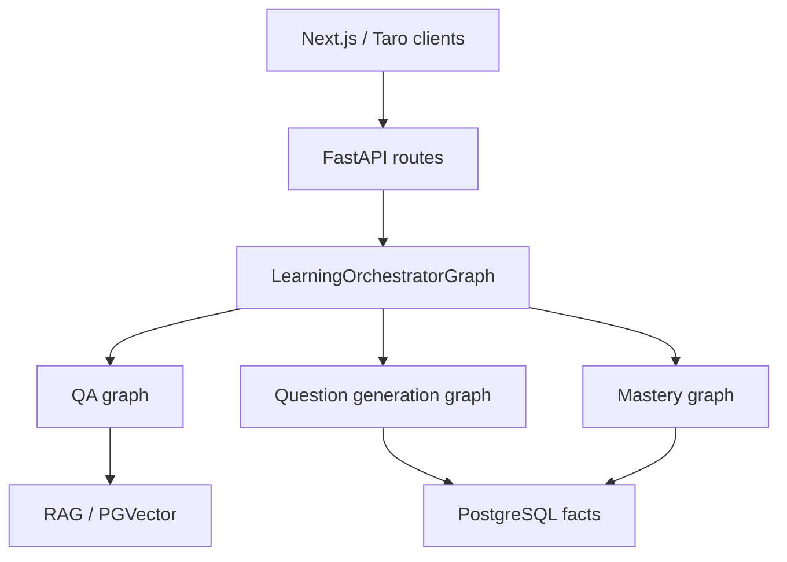

# Learning Assistant

[简体中文](README.md) | **English**

Learning Assistant is an experimental, multi-client AI study assistant built with **FastAPI, LangGraph, LangChain, PostgreSQL/PGVector, Next.js and Taro**. It combines notebook-based retrieval-augmented question answering, multiple-choice practice, learning events, and knowledge-mastery tracking.

> **Project status:** Experimental and **NO-GO for public release**. The web client pins Next.js **16.4.2** / React **19.3.0**. Successful builds and authentication CI do not clear historical dataset rights, all dependency advisories, or staging acceptance. Start with the [release candidate runbook](docs/RELEASE_CANDIDATE.md) and [verification ledger](docs/RELEASE_VERIFICATION.md).

## Features and architecture

| Area | Implementation described in this repository |
| --- | --- |
| Knowledge | Notebook-based PDF/URL ingestion and PGVector retrieval |
| Orchestration | LearningOrchestratorGraph with dedicated QAGraph, QuestionGenerationGraph and MasteryEvaluationGraph |
| Practice | Multiple-choice questions, attempts and mastery snapshots |
| Web client | Next.js H5, including streamed responses |
| WeChat mini-program | Taro + React, with streaming and sync/polling fallback |
| Infrastructure | Docker Compose, PostgreSQL, configuration checks and test scripts |

The orchestrator decides which operation to perform; question answering, practice generation and mastery updates have distinct responsibilities. Consult [graph overview](docs/langgraph-overview.md) and [feature flows](docs/feature-flows.md) for details.

## Why this project

This is for developers building tutoring and practice applications across web and mobile clients. Beyond a single LangGraph example, the code connects routing policy, notebook evidence, structured practice generation, durable learning events, mastery snapshots and mobile async jobs. The separate graphs give each workflow its own persistence and retry boundaries; this is a design rationale, not a measured advantage over other projects.

The production graph entry points live in `backend/app/orchestration/graphs/`; HTTP translation is in `interfaces/api`, use-case orchestration in `application`, and SQL adapters in `persistence/repositories` and `infrastructure/db/repositories`. The following follows the current graph/adaptor boundaries; HTTP practice routes also use application services directly.



QA emits learning events; mastery consumes attempt/event evidence. Provider calls and web tools remain conditional on configuration and source policy. The [Chinese README](README.md) documents deterministic direct responses and more detailed boundaries.

## What works without an API key

- Build both clients, run synthetic contract tests, migrate/bootstrap a disposable database, import the two original example questions, and check local health/login routes.
- The automated HTTP authentication test uses a loopback SMTP sink. Normal UI email registration still needs an SMTP service.
- Arithmetic routing is deterministic. General tutoring, AI question generation and document embeddings require configured providers and may incur charges. Fake/deterministic adapters in tests are not an interactive AI demo mode.
- WeChat account login needs the owner's AppID/secret and real-device validation. Tavily/MCP web search and LangSmith are optional.

## Quick start (local development)

Prerequisites include Python 3.13 for native/CI use (development Docker currently uses 3.12), Node.js 22, PostgreSQL with PGVector, and provider credentials for any external model or service you enable. See the full [Chinese setup instructions](README.md) and [deployment guide](docs/DEPLOY.md) for details.

```bash
# From repository root:
cp backend/.env.example backend/.env
# Set a random JWT_SECRET_KEY in backend/.env; placeholders fail startup.
# Set random POSTGRES_* values in root .env; Compose supplies container DB URLs.
# For keyless acceptance use the runbook generator instead; do not overwrite existing .env files.
docker compose up -d --build
```

Development host ports (from `docker-compose.yml`) are **5434 for Postgres, 8003 for FastAPI, and 3003 for Next.js**. The production Compose file is different. All three host ports bind to `127.0.0.1`; containers communicate over the Compose network. Replace predictable development credentials. The runbook generates disposable configuration without provider keys.

For a native backend environment, first configure `backend/.env` with an isolated database URL and random JWT secret as described in the runbook:

```bash
cd backend
python3.13 -m venv .venv313
source .venv313/bin/activate
pip install -r requirements.txt
python scripts/check_environment.py
python scripts/run_migrations_with_diagnostics.py
python scripts/bootstrap_app_data.py --confirm BOOTSTRAP_APP_DATA
python -m app.main
```

Do not commit real `.env` files, user content, credentials or personal data. The mini-program uses a generic `touristappid` by default; set `TARO_APP_ID` or `WECHAT_MINI_APP_ID` locally for your own WeChat application and keep `project.private.config.json` ignored.

## Validation

The repository includes backend, graph and frontend tests. To run the existing local test targets after installing dependencies:

```bash
make test-backend
make test-graphs
make eval-graphs
make check-frontend
make check-weapp
```

These commands have different environment requirements; see the [main README](README.md). GitHub Actions runs every standalone backend test module in a separate interpreter against a disposable PostgreSQL service, plus real HTTP authentication through Next.js/FastAPI, architecture checks, and client builds. Many graph tests use fakes; some repository tests use SQLite. CI does **not** establish live-model quality, external email delivery, browser/mobile UX or deployment acceptance. Use `cd backend && .venv313/bin/python scripts/run_isolated_unittests.py` with `DATABASE_URL`, `TEST_DATABASE_URL` and `POSTGRES_TEST_STRICT=true` for the CI-style backend run; see the verification ledger for exact environment and evidence.

## Open source and contributing

- [Apache-2.0 license text](LICENSE) and [precise license scope](LICENSE-SCOPE.md)
- [Contributing](CONTRIBUTING.md) and [maintenance process](MAINTAINERS.md)
- [Security reporting](SECURITY.md)
- [Third-party dependency notice](THIRD_PARTY.md)
- [Open-source readiness checklist](docs/OPEN_SOURCE_READINESS.md), [data/release audit](docs/DATA_AND_RELEASE_AUDIT.md) and [web-collected question-bank remediation plan](docs/QUESTION_BANK_REMEDIATION.md)
- [Synthetic practice-question example](examples/README.md); the public candidate ships no web-collected question-bank JSON
- [Historical Git exposure review](docs/GIT_HISTORY_EXPOSURE_REVIEW.md) and [private authorized import policy](docs/PUBLIC_DATA_POLICY.md)

**Important:** The owner confirms AI web-searched existing question banks before reorganizing the former 530-question corpus. The **current public source tree no longer includes the five question JSON files**. Source licenses remain unverified and earlier Git commits may still contain the content; this project does not relicense or authorize redistribution of that historical material. The [530-ID review ledger](data/provenance/408-source-review.csv) is historical metadata only. [Read the remediation plan](docs/QUESTION_BANK_REMEDIATION.md). Do not claim historical erasure or full legal clearance.

Project owner: [@Xiaomuw](https://github.com/Xiaomuw). Contributions and genuine user feedback are welcome.
