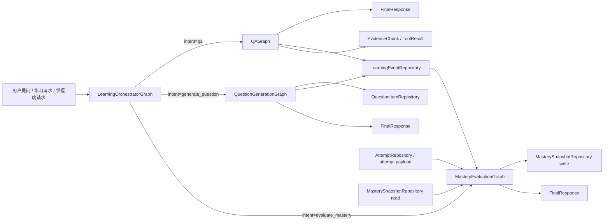

# Graph Relationship Matrix

## 目标

本文档用于校准 `QAGraph`、`QuestionGenerationGraph`、`MasteryEvaluationGraph` 三个业务 Graph 的边界、输入输出、事件流和 repository 依赖。当前 `/api/chat` 已通过 `LearningOrchestratorGraph` 调用这些业务 Graph；`backend/langgraph.json` 的 `learning_assistant` key 仅作为外部平台兼容名保留。

## 总体关系

三个业务 Graph 不直接互相调用。`LearningOrchestratorGraph` 是唯一允许根据意图选择子 Graph 的编排层；业务 Graph 之间通过 `LearningEvent`、共享 contract 和 repository 间接协作。

## 职责矩阵

| Graph | 核心职责 | 明确不负责 | 当前实现状态 |
| --- | --- | --- | --- |
| `QAGraph` | 问答、解释、检索、证据判断、工具 fallback、grounded answer generation、answer repair、产生学习事件 | 不出题，不评分，不写 mastery，不直接写题库或 attempt | 已通过 `ProductionQARuntimeAdapter` 接入 `/api/chat` 的 Orchestrator 路径 |
| `QuestionGenerationGraph` | 根据学习内容生成题目、练习、测验；题目蓝图、候选题、answer key、rubric、solver verifier、quality reviewer、dedupe、difficulty calibration、题目持久化 | 不生成完整教学回答，不更新 mastery，不记录 attempt | 已具备 production graph、质量门和 `QuestionItemRepository` 接口；真实题库 dataset / 人审样本仍需持续校准 |
| `MasteryEvaluationGraph` | 消费 `LearningEvent`、attempt payload 和行为轨迹；区分强/中/弱信号；bounded mastery update；状态分类；下一步学习建议 | 不回答学习问题，不生成题目内容，不调用外部搜索 | 已具备 production graph、`MasterySnapshotRepository`、历史兼容 adapter 和幂等 backfill 路径 |

## 直接调用矩阵

| 调用方 \ 被调用方 | `QAGraph` | `QuestionGenerationGraph` | `MasteryEvaluationGraph` | 说明 |
| --- | --- | --- | --- | --- |
| `QAGraph` | 自身内部节点 | 禁止直接调用 | 禁止直接调用 | 只能输出 `LearningEvent`、`EvidenceChunk`、`FinalResponse` |
| `QuestionGenerationGraph` | 禁止直接调用 | 自身内部节点 | 禁止直接调用 | 可读取 concept/evidence 摘要，但不能触发 QA 或 mastery 写入 |
| `MasteryEvaluationGraph` | 禁止直接调用 | 禁止直接调用 | 自身内部节点 | 只消费事件和 attempts，不生成回答或题目 |
| `LearningOrchestratorGraph` | 允许路由调用 | 允许路由调用 | 允许路由调用 | 只负责路由、上下文加载、响应组合、审计 |

## 事件流

### 1. 用户提问

1. 用户请求进入 `LearningOrchestratorGraph`。
2. `graph_router` 判断为 `qa`。
3. Orchestrator 调用 `QAGraph`。
4. `QAGraph` 生成 `FinalResponse`，同时输出 `EvidenceChunk`、`ToolResult` 和 `LearningEvent`。
5. 若有持久化节点，`QAGraph` 只允许通过 `LearningEventRepository.append` 写入学习事件。

### 2. QAGraph 生成回答后的事件

`QAGraph` 可产生：

- `question_answered`
- `concept_explained`
- `evidence_used`
- `tool_fallback_used`
- `insufficient_evidence`
- `answer_repaired`

这些事件可以被 `MasteryEvaluationGraph` 作为掌握度输入，其中 `question_answered`、可验证答题结果属于更强信号；`concept_explained`、`evidence_used` 等默认是弱信号。

### 3. QGenGraph 基于学习内容生成题目

`QuestionGenerationGraph` 可以使用：

- `ConceptRef`：目标概念、主概念、先修概念。
- `EvidenceChunk`：出题依据、source refs。
- 历史 attempt/mastery 摘要：难度和薄弱点校准。

输出必须包含：

- `QuestionItem`
- `source_refs`
- `primary_concept_id`
- `answer_key`
- `rubric`
- `quality_report`
- `LearningEvent`

`QuestionGenerationGraph` 可产生：

- `question_generated`
- `question_reviewed`
- `question_generation_degraded`
- `question_generation_failed`

这些事件默认不是 mastery 输入信号；真正影响 mastery 的是用户后续 attempt 和评分事件。

### 4. MasteryGraph 更新掌握度

`MasteryEvaluationGraph` 消费：

- `practice_attempt_submitted`
- `attempt_scored`
- `question_answered`
- `concept_explained`
- `evidence_used`
- `tool_fallback_used`
- `insufficient_evidence`
- `answer_repaired`
- `misconception_detected`
- `hint_requested`
- `stuck_reported`

输出：

- `MasterySnapshot`
- `MasteryUpdate`
- `NextLearningAction`
- `FinalResponse`
- 可选审计事件：`mastery_updated`、`next_step_recommended`

`mastery_updated` 和 `next_step_recommended` 不能再次作为 mastery 输入消费，避免事件回流循环。

## 共享 Contract 使用矩阵

| Contract | QAGraph | QuestionGenerationGraph | MasteryEvaluationGraph | 边界说明 |
| --- | --- | --- | --- | --- |
| `ConceptRef` | 识别解释主题、回答涉及概念 | 题目主概念、关联概念、source refs | 掌握度更新的 concept key | 不用于直接存储 DB connection 或 runtime object |
| `EvidenceChunk` | verified notebook/web/model evidence，最终答案引用依据 | 题目依据和 source refs | 可作为弱信号来源 | `raw_retrieved_docs` 不能直接变成最终 evidence |
| `ToolResult` | notebook/web/code 等工具结果摘要 | 可选用于出题资料补充 | 默认不使用外部工具 | 只保存摘要、状态、latency、evidence，不保存敏感工具正文 |
| `LearningEvent` | 输出学习事件 | 输出出题事件 | 消费学习事件并输出审计事件 | event type 以 `LearningEventType` 常量集合为准 |
| `FinalResponse` | 面向用户的学习回答 | 出题完成摘要和 UI payload | 掌握度评估摘要和建议 | Orchestrator 只组合，不压扁子图字段 |
| `GraphError` | runtime/tool/fallback/grounding 错误 | generation/quality/persist 错误 | grading/update/persist 错误 | 错误进入 state，不抛到生产 API 之外 |

## Repository 依赖矩阵

| Repository Interface | QAGraph | QuestionGenerationGraph | MasteryEvaluationGraph | 当前接入状态 |
| --- | --- | --- | --- | --- |
| `LearningEventRepository` | 写：`question_answered` 等 QA 事件 | 写：`question_generated` 等出题事件 | 读：mastery 可消费事件；可选写输出审计事件 | SQL repository 已落地 |
| `QuestionItemRepository` | 禁止写入 | 写：`create_question_item`；读：`find_similar` 去重 | 禁止写入 | SQL repository 已落地 |
| `AttemptRepository` | 禁止写入 | 禁止写入；可读历史 attempt 摘要用于难度校准 | 读：recent attempts / attempt payload | SQL repository 已落地，旧 attempts 可通过兼容 adapter 读取 |
| `MasterySnapshotRepository` | 禁止写入 | 禁止写入；可读 mastery 摘要用于出题校准 | 唯一写入：`upsert_snapshot`；可读历史 snapshot | SQL repository 已落地，旧 knowledge stats 可通过兼容 adapter 读取 |
| `NotebookChunkRepository` | 读：notebook evidence | 读：题目 source refs | 默认不直接读 | 真实检索仍在旧 RAG / adapter 中，后续需要 repository 化 |
| `ConceptRepository` | 读：概念识别/别名 | 读：概念和先修关系 | 读：先修传播和状态分类 | 目前主要是 contract 预留 |
| `ToolRunRepository` | 可写工具审计摘要 | 可写工具审计摘要 | 默认不写 | SQL repository 已落地 |
| `GraphRunRepository` | 由 Orchestrator / runner 记录 | 由 Orchestrator / runner 记录 | 由 Orchestrator / runner 记录 | SQL repository 已落地 |

## ToolCapability 边界矩阵

| Capability | QAGraph | QuestionGenerationGraph | MasteryEvaluationGraph | Policy 约束 |
| --- | --- | --- | --- | --- |
| `notebook_retrieve` | 允许，作为辅助或 strict notebook evidence | 允许，用于 source refs | 默认不需要 | `notebook_only` 下唯一允许的工具 |
| `web_search` | 按需允许；时效/来源/低置信问题可用 | 必要时允许补权威出题依据 | 禁止默认使用 | 必须通过 `ToolPolicyResolver`，不能直接 import Tavily |
| `web_extract` | 可配合 web search 做证据抽取 | 可用于来源片段抽取 | 禁止默认使用 | `notebook_plus_external` / `open_tools` 才允许 |
| `sql_read` | 暂不建议 | 禁止默认使用 | 只能通过 repository/read adapter | 不能把任意 SQL 暴露给模型 |
| `code_execute` | 可用于学习题代码解释或验证，需单独 guard | 禁止默认使用 | 禁止默认使用 | 高风险能力，测试模式默认受限 |
| `file_parse` | 暂不建议直接使用 | 可作为后续资料导入链路能力 | 禁止默认使用 | 不应绕过 ingest / repository |

## source_policy 边界

| source_policy | QAGraph | QuestionGenerationGraph | MasteryEvaluationGraph |
| --- | --- | --- | --- |
| `notebook_only` | 只允许 notebook evidence；资料不足返回 `insufficient_evidence`，不能编造 | 题目必须有 notebook source refs，否则 fail/degraded | 不改变已落库 mastery；只消费已有事件 |
| `notebook_plus_external` | notebook + web 只读工具可用，仍需 relevance/grounding | 可以用 notebook 和外部权威资料出题 | 默认不需要外部工具 |
| `open_tools` | capability 白名单内按需工具 | capability 白名单内按需工具 | 仍以 repository/attempt/event 为主 |

## Mock / Adapter / Real 接入状态

| 区域 | 当前状态 | 下一步 |
| --- | --- | --- |
| QAGraph 默认回答 | deterministic adapter | 继续保留测试默认路径 |
| QAGraph production runtime | `ProductionQARuntimeAdapter` 已包装 `domains.qa.runtime` 并接入 Orchestrator；外露工具名已收口到 capability | 后续只在 provider / compat 层维护旧工具包装 |
| QGenGraph 默认出题 | deterministic generator | 保留单测默认路径 |
| QGenGraph production generator | 生产 graph 已可生成 `QuestionItem`，通过质量门并写入 repository | 持续补真实题库 dataset / 人审样本 |
| QGenGraph question repository | graph-era `question_items` SQL repository 已落地 | 旧题库历史数据如需统一报表，单独 backfill |
| MasteryGraph 默认更新 | minimal bounded update | 保留 contract 测试路径 |
| MasteryGraph attempts | graph-era `attempts` SQL repository 已落地；旧 attempts 可通过 recent-attempt adapter 兼容读取 | 真实环境 backfill 前先 dry-run |
| MasteryGraph snapshots | graph-era `mastery_snapshots` SQL repository 已落地 | 历史 `user_knowledge_stats` 只读兼容 |
| Graph run / tool run facts | `graph_runs / node_runs / tool_runs` SQL repository 已落地 | 继续与 LangSmith run id 对齐 |

## 禁止行为清单

- 禁止业务 Graph 之间直接互相 import 或调用。
- 禁止重新引入旧 graph/workflow/shadow/fallback 作为 `/api/chat` 生产路径。
- 禁止在业务 Graph 节点中直接 import Tavily provider。
- 禁止把 DB connection、LLM client、tool instance 放入 Graph State。
- 禁止把长期业务事实只存在 LangGraph checkpoint。
- 禁止 QAGraph / QuestionGenerationGraph 写 `mastery_snapshots`。
- 禁止 MasteryEvaluationGraph 生成完整教学回答或题目正文。
- 禁止 `question_generated` 等出题事件直接作为 mastery 输入。
- 禁止 `mastery_updated` / `next_step_recommended` 回流为 mastery 输入。
- 禁止无限 retry / repair loop。
