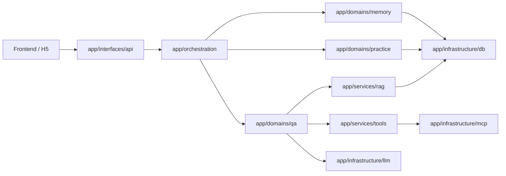

# Learning Assistant 后端设计思路与核心逻辑

> 面向对象：新接手后端的开发同学  
> 当前代码基线：`backend/app/`（模块化单体）

> 说明：旧顶层兼容目录已经删除，真实实现统一在 `backend/app/...`。`backend/main.py` 只做启动转发。

## 1. 设计目标与核心原则

这个后端不是一组松散的聊天接口，而是一个围绕“学习过程”组织起来的模块化单体。核心目标有 4 个：

1. 让回答更像教学过程，而不是一次性答案。
2. 让系统能持续积累用户的学习轨迹和薄弱点。
3. 让问答尽可能基于当前 notebook 的知识内容，而不是纯模型幻觉。
4. 让核心链路可编排、可观测、可降级，不因外部能力失败直接把主流程打断。

围绕这 4 个目标，现在的架构原则是：

- **模块化单体**：按 `interfaces / orchestration / domains / services / infrastructure / shared` 划分。
- **状态驱动**：问答链路围绕统一 `AgentState` 运转。
- **图编排优先**：LangGraph 负责分流和调度，领域层负责具体逻辑。
- **能力分层**：QA、memory、practice、retrieval、llm、db、tools、mcp 各有边界。
- **单一事实来源**：`app/` 是唯一后端实现入口，旧顶层兼容目录已下线。

---

## 2. 当前总体架构

### 2.1 各层职责

- `backend/app/main.py`
  - 正式应用入口。
  - 负责加载环境、初始化 FastAPI、挂载路由、启动 DB/LangSmith/MCP/Workflow runtime。

- `backend/app/interfaces/*`
  - 对外接入层。
  - 包括 API 路由、鉴权、邮箱验证码、HTTP MCP 适配。

- `backend/app/orchestration/*`
  - 编排层。
  - 包含 LangGraph 节点函数、图定义、runner、compiled runtime 生命周期。

- `backend/app/domains/*`
  - 领域层。
  - `qa` 负责主问答 runtime。
  - `memory` 负责短期/中期/长期记忆装配与更新。
  - `practice` 负责题库、做题记录、推荐与练习逻辑。

- `backend/app/services/rag/*`
  - 应用服务层。
  - 统一承接 PGVector 检索、入库、查询补全。

- `backend/app/infrastructure/*`
  - 基础设施层。
  - `llm`：模型 provider、model profile、LangSmith。
  - `db`：SQLAlchemy engine、models、repositories。
  - `tools`：内部 tool registry / executor / facade。

- `backend/app/shared/*`
  - 跨模块共享 schema 与契约。

---

## 3. 为什么用 LangGraph：把“教学流程”显式化

这个项目不是让一个大模型自由发挥，而是把学习链路编码成一张图：

- 先判断问题是什么类型。
- 再按类型进入不同节点。
- 主问答链路里再决定是否用内部工具、外部 MCP、结构化输出或 fallback。
- 最终把结果沉淀到记忆层和会话层。

### 3.1 当前主图的实际分流

主定义在：
- [backend/app/orchestration/graph/graph.py](/Users/xiaomu/Desktop/Python/Code/learning-assistant/backend/app/orchestration/graph/graph.py)

当前路径是：

- `concept / problem`：`preflight_node -> router -> qa_agent_node -> memory_node -> finalize_node -> END`
- `review`：`preflight_node -> router -> qa_agent_node -> quiz_gen -> memory_node -> finalize_node -> END`
- `practice`：`preflight_node -> router -> quiz_gen -> memory_node -> finalize_node -> END`
- `mcq_problem`：`preflight_node -> router -> mcq_solver -> memory_node -> finalize_node -> END`
- `meta / smalltalk`：`preflight_node -> router -> meta_node -> finalize_node -> END`
- 图级异常：`... -> graph_error_node -> finalize_node -> END`

这种设计的价值在于：

- **行为可预测**：同类问题走同类路径。
- **便于观测**：节点、工具、fallback、MCP 使用情况都能打到 LangSmith。
- **便于扩展**：新增题库链路、章节链路、外部工具时，不需要重写整套主流程。

---

## 4. 统一状态 `AgentState`：系统的公共语言

共享状态定义在：
- [backend/app/shared/schemas/state.py](/Users/xiaomu/Desktop/Python/Code/learning-assistant/backend/app/shared/schemas/state.py)

这是整个图的“公共数据面”，关键字段包括：

- 输入域：
  - `user_id`
  - `session_id`
  - `question`
  - `subject_id`
- 路由域：
  - `question_type`
- 记忆域：
  - `short_term_context`
  - `session_memory_context`
  - `long_term_context`
- 检索域：
  - `contextual_query`
  - `retrieved_docs`
- 输出域：
  - `explanation`
  - `final_answer`
  - `quiz_items`
  - `memory`
- 调试/观测域：
  - `execution_mode`
  - `tool_calls`
  - `degraded`
  - `selected_model_profile`

这带来的好处是：

- 节点之间通过统一 schema 协作，而不是靠隐式参数。
- API、workflow、domains、tools 都能围绕同一份状态扩展。
- SSE 和 sync 接口都能稳定映射同一套中间结果。

---

## 5. 主问答链路怎么运转

主入口在：
- [backend/app/interfaces/api/chat.py](/Users/xiaomu/Desktop/Python/Code/learning-assistant/backend/app/interfaces/api/chat.py)

### 5.1 入口步骤

1. 接收 `ChatRequest`
2. 构建初始 `AgentState`
3. 从 memory domain 组装：
   - 短期记忆
   - 中期会话摘要
   - 长期学习画像
4. 调用 `stream_workflow()` 或 `run_workflow()`
5. 将节点输出映射为 SSE 事件或 sync 响应
6. 将会话、题包、摘要、学习结果写回数据库

### 5.2 为什么保留 SSE

- 用户能看到“正在分类 / 正在讲解 / 正在出题 / 正在更新记忆”的过程感
- 工具调用、fallback、外部 MCP、长上下文处理都更容易在 UI 上渐进反馈
- 对复杂主链路的交互体感更好

---

## 6. 主问答 runtime 的设计逻辑

主问答核心不再是旧的 `retriever -> explainer` 直串，而是：

- [backend/app/orchestration/agents/qa_agent.py](/Users/xiaomu/Desktop/Python/Code/learning-assistant/backend/app/orchestration/agents/qa_agent.py)
- [backend/app/domains/qa/runtime.py](/Users/xiaomu/Desktop/Python/Code/learning-assistant/backend/app/domains/qa/runtime.py)

### 6.1 执行顺序

对 `concept / problem / review` 来说，内部会按以下顺序执行：

1. `create_agent`
2. 读取 `model profile`
3. `preprocess middleware`
4. 决定：
   - `direct_answer`
   - `tool_calling`
   - `structured_output`
   - `deterministic_context`
5. 如需工具，进入 tool loop：
   - 内部 tools
   - 外部 HTTP MCP（可选）
6. `postprocess middleware`
7. 如 structured output 修复失败、工具失败、MCP 不可用，则 fallback

### 6.2 为什么这么做

因为当前主问答已经不是纯 RAG 了，它还要判断：

- 当前模型是否支持 tool calling
- 是否支持 structured output
- 当前上下文窗口够不够
- 是否需要调用 notebook 检索、用户画像、会话摘要、题目推荐，甚至外部网页搜索

所以把“主问答”单独抽成 runtime，是比继续维护独立检索节点和讲解节点更合适的做法。

---

## 7. 各领域模块怎么分工

### 7.1 Memory Domain

目录：
- `backend/app/domains/memory/*`

职责：
- 短期记忆：最近几轮消息
- 中期记忆：会话摘要层
- 长期记忆：用户学习画像、薄弱点、错误统计
- 统一装配与统一更新

这个领域不直接拥有数据库实现，持久化最终仍通过：
- `backend/app/infrastructure/db/repositories/*`

### 7.2 Practice Domain

目录：
- `backend/app/domains/practice/*`

职责：
- 4 选 1 单选题生成
- 本地题库优先 + AI 补题
- 推荐题
- 做题记录
- 正误反馈写入长期记忆与会话摘要

### 7.3 Retrieval Service

目录：
- `backend/app/services/rag/*`

职责：
- PGVector 入库
- notebook 隔离检索
- 查询补全
- 统一检索接口

它属于“应用服务层”，因为它为多个领域复用，但不直接表达完整业务流程。

---

## 8. 数据与存储设计

### 8.1 当前正式运行栈

现在运行时已经统一为 PostgreSQL 单栈：

- 业务事实表：PostgreSQL
- 向量检索：PGVector
- LangGraph 线程持久化：PostgresSaver

历史 MySQL / SQLite / Chroma 只作为迁移来源或兼容资产，不再是正式主链路。

### 8.2 当前数据库的核心事实表

主要包括：

- `subjects`
- `users`
- `user_profiles`
- `user_memories`
- `auth_refresh_tokens`
- `email_verification_challenges`
- `chat_sessions`
- `question_bank_items`
- `practice_attempts`
- `app_settings`

其中：

- `subjects` 在产品语义上等价于 notebook
- `chat_sessions` 是前端历史页的产品事实来源
- `user_profiles + user_memories` 是用户学习状态事实来源
- `question_bank_items + practice_attempts` 是题库和做题事实来源

---

## 9. 模型层与外部能力

### 9.1 LLM Layer

目录：
- `backend/app/infrastructure/llm/*`

职责：
- 统一模型创建 façade
- 环境配置、模型目录、客户端工厂分模块维护
- model profile 能力判断
- embedding 创建
- LangSmith bootstrap 与 tracing 辅助

这让“模型接入”不再是散落在各节点里的隐式逻辑，而是统一基础设施。

### 9.2 Tool Layer

目录：
- `backend/app/services/tools/*`

职责：
- 内部 tool registry
- tool schema
- tool executor
- MCP tool adapter 封装
- 给 QA runtime 提供统一调用界面

当前内置工具包括：

- `search_notebook_context`
- `get_session_summary`
- `get_user_learning_profile`
- `recommend_questions`

### 9.3 MCP Layer

目录：
- `backend/app/infrastructure/mcp/*`

职责：
- 外部 HTTP MCP 适配
- schema 拉取和缓存
- 查询清洗
- MCP 工具调用

当前 V1 只接了：

- `mcp_web_search`
- `mcp_web_read`

并且只在主问答链路里启用。

---

## 10. 鉴权和账号体系

目录：
- `backend/app/interfaces/auth/*`

职责：
- 登录、刷新、退出、改密码
- JWT access/refresh + HttpOnly Cookie
- 邮箱验证码注册
- SMTP 发信

这是当前项目和早期版本最大的变化之一：现在已经有真实账号体系，不再把 `default_user` 当正式业务用户。

---

## 11. 关键设计取舍与边界

### 11.1 取舍

- **模块化单体而非重型六边形**
  - 当前团队规模和项目复杂度下，更适合可快速落地、清晰可读的模块化结构。
- **`subject` 保留兼容，而不是一次性全部改名为 `notebook_id`**
  - 避免这轮重构引入大面积接口、数据迁移和前后端联动风险。
- **保留旧目录 shim**
  - 给测试、脚本、迁移期代码一个缓冲层。
- **MCP / LangSmith 默认可关**
  - 外部能力失败时不阻断核心问答。

### 11.2 当前边界

- MCP V1 只支持 HTTP，不支持 stdio
- 主问答 runtime 只覆盖 `concept / problem / review`
- 练习页当前只支持文本单选题，不做 OCR / 图片识题
- `subject` 内部命名还在，后续如果要统一 notebook 语义，需要单独做数据迁移批次

---

## 12. 推荐阅读顺序

建议按下面顺序阅读源码：

1. [backend/app/main.py](/Users/xiaomu/Desktop/Python/Code/learning-assistant/backend/app/main.py)
2. [backend/app/interfaces/api/chat.py](/Users/xiaomu/Desktop/Python/Code/learning-assistant/backend/app/interfaces/api/chat.py)
3. [backend/app/orchestration/graph/graph.py](/Users/xiaomu/Desktop/Python/Code/learning-assistant/backend/app/orchestration/graph/graph.py)
4. [backend/app/orchestration/agents/*.py](/Users/xiaomu/Desktop/Python/Code/learning-assistant/backend/app/orchestration/agents)
5. [backend/app/domains/qa/runtime.py](/Users/xiaomu/Desktop/Python/Code/learning-assistant/backend/app/domains/qa/runtime.py)
6. [backend/app/domains/memory/service.py](/Users/xiaomu/Desktop/Python/Code/learning-assistant/backend/app/domains/memory/service.py)
7. [backend/app/services/rag/rag_service.py](/Users/xiaomu/Desktop/Python/Code/learning-assistant/backend/app/services/rag/rag_service.py)
8. [backend/app/services/tools/runtime.py](/Users/xiaomu/Desktop/Python/Code/learning-assistant/backend/app/services/tools/runtime.py)
9. [backend/app/infrastructure/db/repositories](/Users/xiaomu/Desktop/Python/Code/learning-assistant/backend/app/infrastructure/db/repositories)

---

## 13. 一句话总结

这个后端的本质不是“聊天接口 + 一些工具函数”，而是一套围绕统一状态、显式编排、领域分层和基础设施边界组织起来的**学习过程系统**：

- 先分类问题，
- 再进入主问答或专项分支，
- 必要时调用内部工具和外部 MCP，
- 最后把学习结果沉淀进数据库与三层记忆，
- 并通过同步或流式协议反馈给前端。
