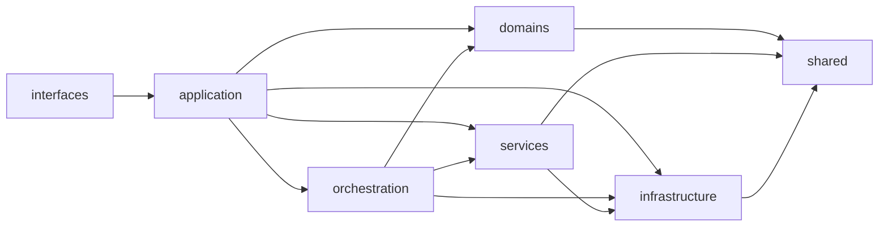
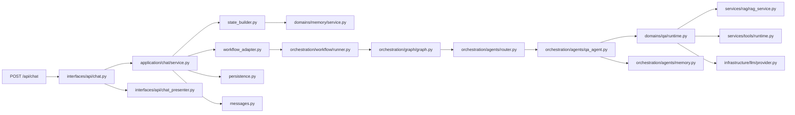
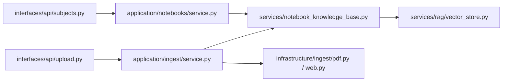

# 后端最终结构图与维护约定

> 更新日期：2026-04-28  
> 适用范围：`backend/app/*`  
> 目标读者：项目维护者、协作 AI、后续接手同学

这份文档不重复介绍“项目做什么”，而是专门回答两个问题：

1. 这套后端现在**应该如何理解**
2. 后续改代码时，**哪些边界不能再打穿**

如果你只想最快建立正确心智模型，先看：

1. [AI 交接卡](ai-handoff.md)
2. [后端目录能力地图](backend-map.md)
3. [功能流程图](feature-flows.md)
4. [backend/app/main.py](/Users/xiaomu/Desktop/Python/Code/learning-assistant/backend/app/main.py)
5. [backend/app/interfaces/api/chat.py](/Users/xiaomu/Desktop/Python/Code/learning-assistant/backend/app/interfaces/api/chat.py)
6. [backend/app/application/chat/service.py](/Users/xiaomu/Desktop/Python/Code/learning-assistant/backend/app/application/chat/service.py)
7. [backend/app/orchestration/graph/graph.py](/Users/xiaomu/Desktop/Python/Code/learning-assistant/backend/app/orchestration/graph/graph.py)
8. [backend/app/domains/qa/runtime.py](/Users/xiaomu/Desktop/Python/Code/learning-assistant/backend/app/domains/qa/runtime.py)

## 1. 最终结构图



可以把它记成一句话：

**接口层只翻译协议，application 只编排用例，orchestration 只编排图，domains 只放领域逻辑，services 连接跨领域能力，infrastructure 只做适配器。**

## 2. 每层到底负责什么

### 2.1 `interfaces/`

职责：

- FastAPI 路由
- 鉴权依赖
- SSE 输出
- 请求 DTO 校验
- 把 application 错误映射成 `HTTPException`
- 把内部契约对象转换成最终 JSON

不该做：

- 直接拼 `AgentState`
- 直接读写仓储
- 直接操作向量库
- 直接决定活动模型
- 直接写业务规则

一句话：

**`interfaces/*` 是唯一 HTTP 翻译层。**

### 2.2 `application/`

职责：

- 承接一个完整 use case
- 编排 workflow、领域服务、基础设施能力
- 返回内部契约对象
- 抛应用层错误

不该做：

- 直接抛 `HTTPException`
- 直接返回 HTTP 风格响应
- 直接实现底层 IO

当前典型入口：

- [backend/app/application/auth/service.py](/Users/xiaomu/Desktop/Python/Code/learning-assistant/backend/app/application/auth/service.py)
- [backend/app/application/chat/service.py](/Users/xiaomu/Desktop/Python/Code/learning-assistant/backend/app/application/chat/service.py)
- `backend/app/application/chat/state_builder.py`
- `backend/app/application/chat/workflow_adapter.py`
- `backend/app/application/chat/persistence.py`
- `backend/app/application/chat/messages.py`
- [backend/app/application/notebooks/service.py](/Users/xiaomu/Desktop/Python/Code/learning-assistant/backend/app/application/notebooks/service.py)
- [backend/app/application/ingest/service.py](/Users/xiaomu/Desktop/Python/Code/learning-assistant/backend/app/application/ingest/service.py)
- [backend/app/application/model_config/service.py](/Users/xiaomu/Desktop/Python/Code/learning-assistant/backend/app/application/model_config/service.py)

一句话：

**`application/*` 负责“做成一件事”，但不负责底层协议和底层实现。**

### 2.3 `orchestration/`

职责：

- LangGraph 节点
- 图结构
- runner/runtime
- checkpointer 生命周期

不该做：

- 直接变成 HTTP 层
- 承担基础设施细节
- 吞掉领域模型边界

一句话：

**`orchestration/*` 只管“图怎么跑”。**

### 2.4 `domains/`

职责：

- QA 领域逻辑
- memory 领域逻辑
- practice 领域逻辑

不该做：

- 挂 HTTP 协议语义
- 到处暴露基础设施 helper
- 变成“半仓储工具箱”

一句话：

**`domains/*` 只表达学习助手的业务规则。**

### 2.5 `services/`

职责：

- 跨领域应用服务
- notebook 知识库 gateway
- retrieval 高层服务
- QA tools registry / executor
- 当前活动模型决策

当前正式入口：

- [backend/app/services/rag/rag_service.py](/Users/xiaomu/Desktop/Python/Code/learning-assistant/backend/app/services/rag/rag_service.py)
- [backend/app/services/tools/runtime.py](/Users/xiaomu/Desktop/Python/Code/learning-assistant/backend/app/services/tools/runtime.py)
- [backend/app/services/runtime_models.py](/Users/xiaomu/Desktop/Python/Code/learning-assistant/backend/app/services/runtime_models.py)
- [backend/app/services/notebook_knowledge_base.py](/Users/xiaomu/Desktop/Python/Code/learning-assistant/backend/app/services/notebook_knowledge_base.py)

一句话：

**`services/*` 用来承接“不是单一领域，但也不该直接落到基础设施里”的能力。**

### 2.6 `infrastructure/`

职责：

- 数据库
- LLM provider façade / model catalog / client factory
- PDF / URL ingest adapter
- 外部服务适配

不该做：

- 读 HTTP 请求
- 决定业务流程
- 读取 application 语义来做上层决策

一句话：

**`infrastructure/*` 只负责“怎么连外部世界”。**

## 3. 正式入口

新增代码默认只应该从这些位置进入：

- `app.interfaces.*`
- `app.application.*`
- `app.orchestration.*`
- `app.domains.*`
- `app.services.*`
- `app.infrastructure.*`
- `app.shared.*`

旧顶层兼容目录与 deprecated façade 已经删除。维护规则是：

- 普通业务代码、测试、脚本必须走正式 `app.*` 入口
- 不再新增 compatibility suite 来保护旧路径
- `app.infrastructure.db.repositories` 包根只导出正式 record 仓储能力，不再导出旧 helper
- `app.infrastructure.llm.selection`、`app.infrastructure.tools`、`app.services.retrieval.store`、`app.interfaces.mcp` 不允许恢复
- 架构守卫会阻止旧目录和 deprecated façade 回流

## 4. 现在的主问答链路



阅读重点：

- `interfaces/api/chat.py` 负责 HTTP 入口
- `interfaces/api/chat_presenter.py` 负责 SSE 节点事件映射
- `application/chat/service.py` 负责 use case façade
- `application/chat/state_builder.py` 负责 `AgentState` 装配
- `application/chat/workflow_adapter.py` 负责 workflow 调用隔离
- `application/chat/persistence.py` 负责会话、latest quiz、记忆快照持久化
- `application/chat/messages.py` 负责持久化消息和过程面板结构
- `orchestration/*` 负责 LangGraph 执行
- `domains/qa/runtime.py` 负责主问答 runtime façade
- `domains/qa/mode_selection.py`、`tool_loop.py`、`answer_generation.py` 拆分主问答执行细节
- `services/rag/rag_service.py` 是 RAG 正式入口
- `services/tools/runtime.py` 是工具执行聚合入口；registry / internal tools / MCP tools 已拆到 `services/tools/*`

## 5. 现在的 notebook / ingest 链路



这条链路现在的维护原则是：

- application 只表达“创建 notebook / 生成知识内容 / ingest 内容”
- 不再直接知道 `count_collection_documents`、`delete_collection`、`ingest_documents` 这些底层函数名
- 底层知识库操作统一经由 `notebook_knowledge_base.py`

## 6. 内部契约约定

当前默认策略：

- 对外 API：保持现有 JSON 结构兼容
- 对内边界：优先用明确契约对象

典型内部契约现在集中在：

- [backend/app/shared/schemas/contracts.py](/Users/xiaomu/Desktop/Python/Code/learning-assistant/backend/app/shared/schemas/contracts.py)

重点包括：

- `ChatExecutionResult`
- `RetrievedDocument`
- `PracticeRecommendation`
- `PracticeSubmissionResult`
- `AuthUserView`
- `ModelConfigSnapshot`
- `IngestResult`

维护约定：

- `model_dump()` 和裸 `dict` 不应再作为内部主路径默认协议
- 只有这几类地方可以接受裸 `dict`
  - FastAPI 响应最终转换
  - LangGraph `AgentState` / workflow state
  - 数据库 JSON 字段或外部 API payload 的边界转换

## 7. 新增代码时的硬规则

### 7.1 可以做

- 在 `interfaces/*` 把 application 错误翻译成 HTTP
- 在 `application/*` 组装一个完整用例
- 在 `services/*` 增加跨领域 gateway
- 在 `infrastructure/*` 增加新的外部 adapter
- 在 `shared/schemas/contracts.py` 里补新的内部契约

### 7.2 不可以做

- 在 `application/*` 里直接抛 `HTTPException`
- 在 `interfaces/*` 里直接操作 repo / vector store / provider
- 在 `domains/*` 里塞一层新的“半工具箱”
- 在 `infrastructure/*` 里做活动模型这种上层决策
- 恢复旧顶层目录或 deprecated façade
- 在普通测试或脚本里为了省事导入旧路径

## 8. 维护时优先检查什么

每次做后端改动，优先自检这 5 件事：

1. 有没有把 HTTP 语义带回 `application/*`
2. 有没有又让新代码依赖 shim
3. 有没有把内部契约退化回裸 `dict`
4. 有没有让 use case 直接碰底层向量库/模型实现细节
5. tests/scripts 有没有重新沿着旧目录写

## 9. 推荐的最低自检命令

```bash
backend/.venv313/bin/python -m py_compile $(find backend/app backend/tests -name '*.py')
backend/.venv313/bin/python -m unittest discover -s backend/tests -v
```

如果改到了前端联动，再补：

```bash
cd frontend && npm run lint && npm run build
```

## 10. 文档和交接约定

- 项目总文档入口是 [docs/README.md](README.md)。
- 后续 AI 接手先看 [docs/ai-handoff.md](ai-handoff.md)，不要从历史需求或旧数据库文档推断当前状态。
- 如果文档里出现 MySQL、SQLite、Chroma、`default_user` 正式运行等口径，默认视为历史背景，除非该文档明确写着“当前事实源”。
- 文档不允许包含真实 LangSmith key、SMTP 授权码、模型密钥。

## 11. 下一阶段还能继续做什么

如果后面还要继续追求更“纯”的结构，优先级建议是：

1. 进一步减少 chat/workflow 内部 `dict-first` 传递
2. 给更多 application use case 补齐内部契约对象
3. 逐步把领域层里的持久化 gateway 做得更窄
4. 为更多浏览器主流程补自动化 smoke 覆盖

当前不建议做的事：

- 现在就把 `subject` 全量重命名成 `notebook_id`
- 为了“范式漂亮”重写 LangGraph state 体系

因为这些事的风险和收益现在还不成比例。
