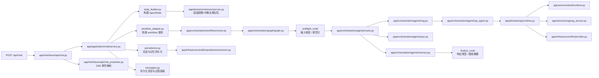

# 后端目录能力地图

> 适用代码：`backend/`  
> 更新日期：2026-04-28  
> 当前事实来源：`backend/app/`

## 1. 先看什么

如果你第一次接手这套后端，建议按这个顺序读：

1. [backend/app/main.py](/Users/xiaomu/Desktop/Python/Code/learning-assistant/backend/app/main.py)
2. [backend/app/interfaces/api/chat.py](/Users/xiaomu/Desktop/Python/Code/learning-assistant/backend/app/interfaces/api/chat.py)
3. [backend/app/application/chat/service.py](/Users/xiaomu/Desktop/Python/Code/learning-assistant/backend/app/application/chat/service.py)
4. `backend/app/application/chat/{state_builder,workflow_adapter,persistence,messages}.py`
5. [backend/app/orchestration/graph/graph.py](/Users/xiaomu/Desktop/Python/Code/learning-assistant/backend/app/orchestration/graph/graph.py)
6. [backend/app/orchestration/workflow/runner.py](/Users/xiaomu/Desktop/Python/Code/learning-assistant/backend/app/orchestration/workflow/runner.py)
7. `backend/app/orchestration/agents/*`
8. `backend/app/domains/*` / `backend/app/services/*` / `backend/app/infrastructure/*`
9. [backend/app/services/runtime_models.py](/Users/xiaomu/Desktop/Python/Code/learning-assistant/backend/app/services/runtime_models.py)
10. [backend/app/infrastructure/ingest/pdf.py](/Users/xiaomu/Desktop/Python/Code/learning-assistant/backend/app/infrastructure/ingest/pdf.py)

启动排障优先补一眼：

- [backend/scripts/check_environment.py](/Users/xiaomu/Desktop/Python/Code/learning-assistant/backend/scripts/check_environment.py)
- [backend/.env.example](/Users/xiaomu/Desktop/Python/Code/learning-assistant/backend/.env.example)

`backend/main.py` 只做启动转发；业务阅读与新增代码都应从 `backend/app/...` 开始。

## 2. 目录怎么理解

```text
backend/
├── app/
│   ├── interfaces/
│   │   ├── api/      # HTTP 路由、SSE、请求/响应 DTO
│   │   └── auth/     # 登录注册、JWT、cookie、邮箱验证码、SMTP 的 HTTP 翻译层
│   ├── application/  # auth / chat / notebooks / ingest / model_config 等用例编排
│   ├── orchestration/
│   │   ├── agents/   # LangGraph 节点函数
│   │   ├── graph/    # 图结构、条件分流、节点装配
│   │   ├── workflow/ # runner、runtime、compiled graph 生命周期
│   │   └── platform/ # LangGraph Platform sidecar graph / lifespan
│   ├── domains/
│   │   ├── practice/ # 题库、推荐、做题记录
│   │   ├── qa/       # 主问答 runtime、middleware、tool loop、schema
│   │   └── memory/   # 短期 / 中期 / 长期记忆装配与更新
│   ├── services/
│   │   ├── rag/          # RAG loader/splitter/embedding/vector/retriever/service
│   │   ├── retrieval/    # 迁移期薄兼容壳；新增代码不要使用
│   │   └── runtime_models.py # 当前活动模型选择
│   ├── infrastructure/
│   │   ├── llm/      # model provider、profile、LangSmith
│   │   ├── ingest/   # PDF / URL 文本提取 adapter
│   │   ├── db/       # SQLAlchemy、models、repositories
│   │   └── mcp/      # 外部 HTTP MCP adapter
│   └── shared/
│       └── schemas/  # AgentState、内部契约、subject/notebook 兼容契约
├── tests/
├── scripts/
├── storage/
│   ├── chroma_data/
│   └── data/
└── main.py           # 启动转发入口 -> app.main:app
```

## 3. 一个聊天请求是怎么走的



你只需要记住：

- `app/interfaces/api/chat.py` 是薄控制器，只做 HTTP 入参、鉴权、SSE 包装和响应映射
- `app/interfaces/api/chat_presenter.py` 只做 SSE 节点事件到 HTTP 事件的映射
- `app/interfaces/auth/router.py` 现在只做 HTTP / cookie 翻译，认证编排已下沉到 `app/application/auth/service.py`
- `app/application/chat/service.py` 是 chat use case façade，只协调 state builder、workflow adapter 和 persistence
- `app/application/chat/state_builder.py` 负责把请求上下文装配成 `AgentState`
- `app/application/chat/workflow_adapter.py` 负责隔离 `orchestration.workflow` 调用
- `app/application/chat/persistence.py` 负责会话消息、latest quiz 和记忆快照持久化
- `app/application/chat/messages.py` 负责持久化 assistant message 与过程面板结构
- `app/application/*` 现在不再直接抛 `HTTPException`；应用层错误统一留给 `interfaces/*` 做 HTTP 映射
- `app/services/runtime_models.py` 是“当前活动模型”的唯一决策入口
- `app/orchestration/*` 负责图编排和节点调度
- 当前 LangGraph 主拓扑是 `preflight_node -> router -> rag_node/分支节点 -> qa_agent_node/专项节点 -> memory_node / graph_error_node -> finalize_node -> END`
- `app/orchestration/platform/*` 只服务 LangGraph Platform sidecar，不挂载现有 FastAPI 业务路由
- `app/domains/*` 负责 QA / memory / practice 的领域逻辑
- `app/domains/qa/runtime.py` 是主问答 façade；mode selection、tool loop、answer generation、fallback 已拆到 `app/domains/qa/*`
- `app/domains/practice/service.py` 是兼容 façade；出题、判题、attempt、导入分别在 `app/domains/practice/*`
- `app/services/rag/*` 是 RAG 正式入口：loader、splitter、embeddings、vector_store、retriever、rag_service
- `app/services/retrieval/*` 仅是迁移期薄兼容壳，不作为新增代码入口
- `app/services/tools/*` 是 QA 工具 registry / executor / internal tools / MCP tools 的正式入口
- `app/infrastructure/ingest/*` 负责 PDF / URL 内容提取
- `app/infrastructure/llm/provider.py` 是 LLM façade；环境配置、模型目录和客户端工厂已拆到 `config.py`、`catalog.py`、`clients.py`
- `app/services/notebook_knowledge_base.py` 是 notebook 知识库的正式 gateway，use case 不再直接调用底层向量库函数
- `app/infrastructure/db/repositories/__init__.py` 只导出当前正式仓储能力；正式仓储入口是 `subjects.py`、`sessions.py`、`users.py`、`settings.py`、`practice.py` 等子模块

## 4. 三层记忆在哪里

- 短期记忆：`backend/app/domains/memory/short_term.py`
- 中期记忆：`backend/app/domains/memory/session_summary.py`
- 长期记忆：`backend/app/domains/memory/long_term.py`
- 统一装配入口：`backend/app/domains/memory/service.py`

## 5. notebook 和 subject 的关系

- 产品语义：`notebook / 笔记本`
- 后端兼容实现：`subject_id / subject_name`

当前规则是：

- 文档和能力模块优先使用 notebook 语义来解释系统
- 数据库字段和旧接口继续保留 `subject`
- `/api/subjects` 与 `/api/notebooks` 同时存在

## 6. 旧入口已经删除

旧顶层兼容目录和 deprecated façade 已经下线。现在的规则更简单：

- 新代码一律以 `app.*` 为事实来源
- `backend/tests` 和 `backend/scripts` 只允许导入正式 `app.*` 入口
- 结构守卫会阻止旧顶层目录重新出现
- 结构守卫会阻止 `app.infrastructure.llm.selection`、`app.infrastructure.tools`、`app.services.retrieval.store`、`app.interfaces.mcp` 等 deprecated façade 回流

## 7. 相关文档

- [AI 交接卡](ai-handoff.md)
- [项目当前状态](project-current-status.md)
- [前端目录能力地图](frontend-map.md)
- [功能流程图](feature-flows.md)
- [后端维护约定](backend-maintenance-guide.md)
