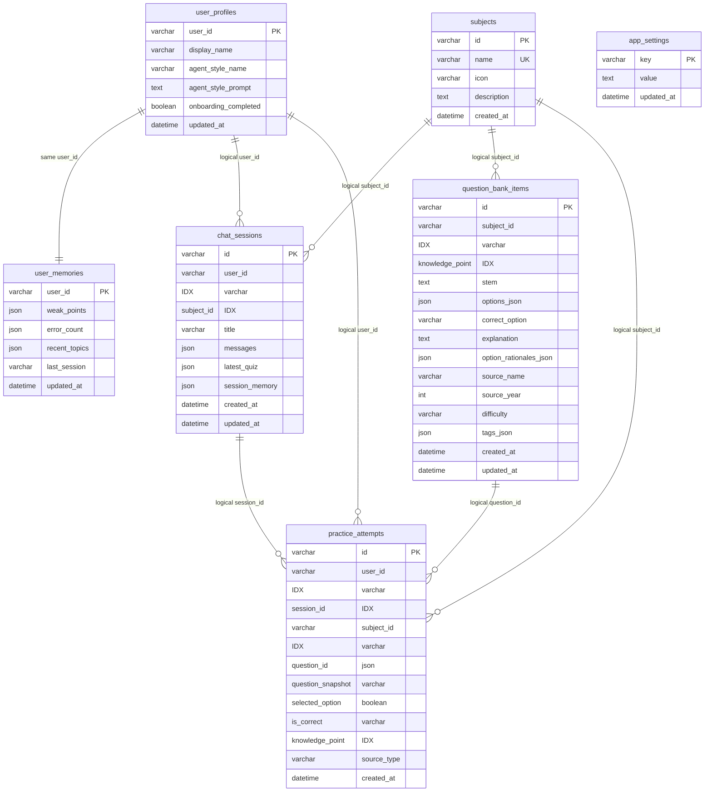

# 学习助手数据库 ER 图

> 更新日期：2026-04-16  
> 说明：这是**当前项目逻辑关系图**，不是物理外键图。当前数据库层没有显式外键约束，关系主要由应用层维护。

## 1. 逻辑关系图

## 2. 关系解释

### `subjects` 与业务实体

- `subjects` 是当前数据库层里的 notebook 兼容实现
- 一个 `subject/notebook` 可以拥有：
  - 多条聊天记录 `chat_sessions`
  - 多道真题/题库题 `question_bank_items`
  - 多条做题记录 `practice_attempts`

### `user_profiles` / `user_memories`

- 当前没有单独 `users` 主表
- `user_profiles` 与 `user_memories` 通过同一个 `user_id` 组成用户的两块核心扩展数据：
  - `user_profiles`：昵称、风格、引导状态
  - `user_memories`：学习画像

### `chat_sessions`

- 是聊天事实主表
- 同时承担：
  - 历史消息存档
  - 最新题包存档
  - 会话摘要存档

### `question_bank_items`

- 是本地题库镜像表
- 用于承接导入的历年真题
- 当前推荐与混合出题都依赖它

### `practice_attempts`

- 是选择题提交事实表
- 每次用户作答都会落一条记录
- 与 `chat_sessions` 和 `question_bank_items` 都有逻辑关联，但当前无物理 FK

### `app_settings`

- 属于系统级 KV 配置表
- 当前主要保存 `chat_model`

## 3. 当前数据库关系的现实约束

这张 ER 图需要结合当前实现理解：

- 它描述的是**逻辑关联**
- 当前 PostgreSQL 实际建表时没有显式 `FOREIGN KEY`
- 因此：
  - 删除 `subject` 时，需要业务层决定是否清理关联会话和题库
  - 删除题库题时，不会自动影响历史 `practice_attempts`
  - 做题记录更多是“事件事实”，不是强一致引用

## 4. 推荐演进方向

后续如果数据库要更规范，可以按这个顺序演进：

1. 为高频查询补组合索引
2. 为 `subject / session / question` 补显式外键
3. 如统计需求增强，再逐步拆分高频 JSON 字段
4. 最后再决定是否物理迁移 `subject -> notebook`
