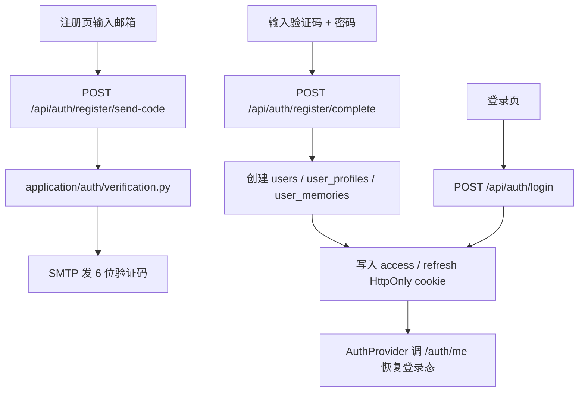
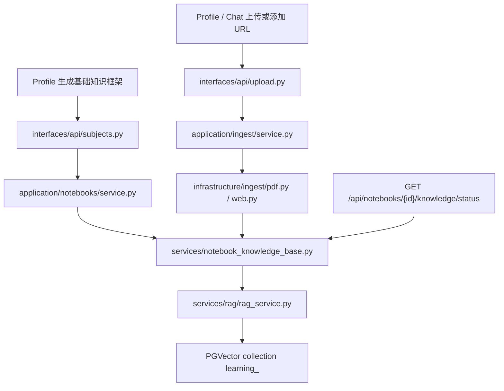
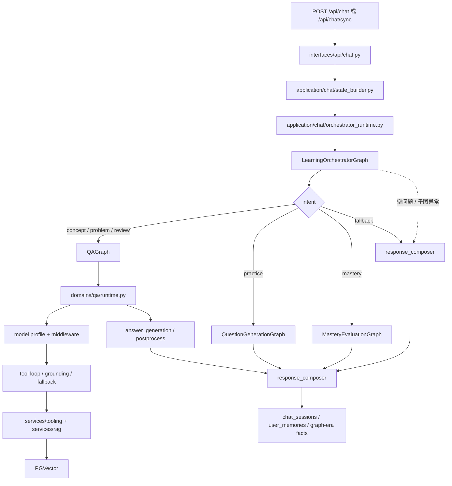
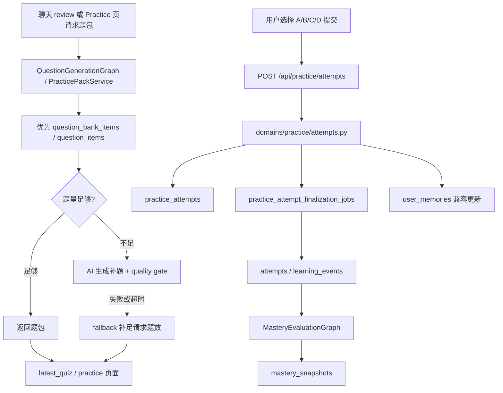
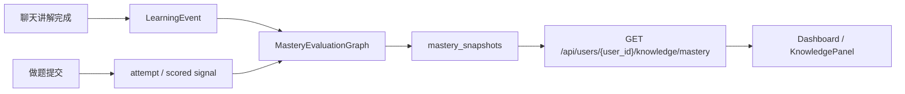
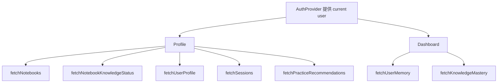
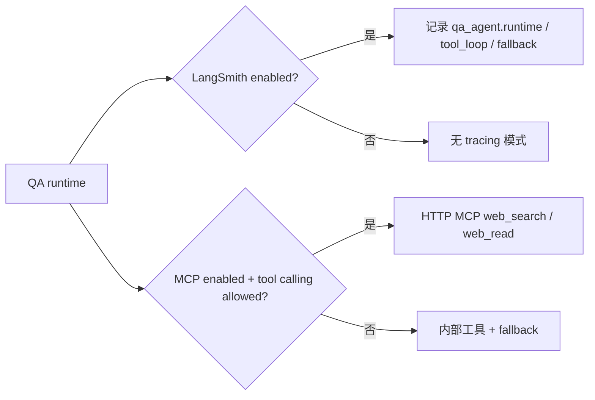

# 主要功能流程图

> 目标：让人和 AI 快速理解“请求从哪里进、经过哪些层、最后写到哪里”。  
> 图里使用 notebook 产品语义；如果看到 `subject_id`，它是后端兼容字段。

## 1. 登录与注册

失败边界：

- SMTP 未配置：发码接口返回明确错误，不创建用户。
- access 过期：前端自动请求 `/api/auth/refresh`。
- refresh 失败：清理本地学习态并回 `/login`。

## 2. Notebook 入库与知识库状态

维护要点：

- URL/PDF/章节/题库向量 metadata 必须包含正确 `subject_id`、`doc_type`、`source_id`。
- 重复入库应走确定性 upsert，避免重复向量。
- Profile 卡片展示的资料数来自 knowledge status，失败时才 fallback 到 notebook `doc_count`。

## 3. 聊天与 RAG

事实型 RAG 问题要求：

- 如果 notebook 检索命中事实，回答优先给直接结论。
- 如果当前 notebook 没检索到该事实，要明确说资料不足，再补一般解释。

## 4. 练习题包与提交作答

提交后前端必须展示：

- 你的答案
- 是否正确
- 正确答案
- 标准解析
- 当前选项为什么对/错

## 5. 知识点掌握度

V1 算法口径：

- 正确率提供主要分数。
- exposure 提供少量加成。
- 错题提供惩罚。
- `mastered >= 80`、`learning >= 50`、`weak < 50`。
- 旧 `user_knowledge_stats` 可作为历史兼容读取来源，不再是 graph-era mastery 的唯一事实表。

## 6. Profile / Dashboard 数据流

维护要点：

- Profile 各请求独立加载，推荐题慢请求不能拖住 notebook 列表。
- Dashboard 学习记忆和掌握度独立加载，接口失败时展示缓存或空态。
- 页面主路径不使用 `default_user`。

## 7. LangSmith / MCP 观测边界

默认策略：

- LangSmith / MCP 都是可选能力。
- 配置缺失或服务不可用时 fail-open，不阻断主问答。
- MCP 不发送完整 notebook 正文、长期记忆或完整会话摘要。
