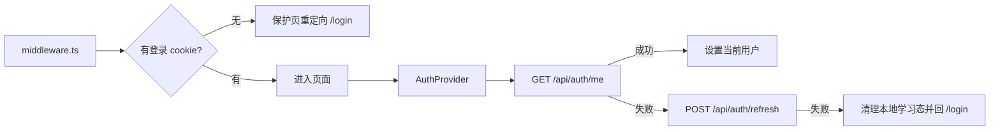

# 前端目录能力地图

> 适用代码：`frontend/`  
> 技术栈：Next.js 14 App Router + H5 移动端 UI  
> 当前事实源：`frontend/app/*`、`frontend/components/*`、`frontend/lib/api.ts`

## 1. 先看什么

第一次接手前端，建议按这个顺序读：

1. `frontend/app/layout.tsx`
2. `frontend/components/AuthProvider.tsx`
3. `frontend/middleware.ts`
4. `frontend/lib/api.ts`
5. `frontend/lib/learning-store.ts`
6. `frontend/app/chat/page.tsx`
7. `frontend/app/practice/page.tsx`
8. `frontend/app/dashboard/page.tsx`
9. `frontend/app/profile/page.tsx`

## 2. 页面职责

- `/login`：邮箱密码登录。
- `/register`：邮箱验证码注册，同页两步流程。
- `/chat`：Notebook 选择、聊天 SSE、RAG 问答、MCQ 判题、题包入口。
- `/practice`：最新题包、推荐题、选择作答、解析展示。
- `/dashboard`：学习记忆与知识点掌握度。
- `/profile`：用户资料、Agent 风格、模型配置、Notebook 管理、历史会话。
- `/help`：辅助说明页。

## 3. Auth 和路由守卫



维护要点：

- 页面不要再使用 `default_user`。
- 当前用户来自 `AuthProvider`。
- refresh 失败时要清空本地 auth snapshot 和学习态。
- 登出调用 `/api/auth/logout`，不是只清前端缓存。

## 4. API 适配边界

`frontend/lib/api.ts` 是唯一 wire 兼容层：

- 后端仍有 `/api/subjects`、`subject_id`。
- 前端页面和组件使用 `Notebook / notebookId / notebooks`。
- `Explanation` 在组件层只使用单一契约：
  - `steps: string[]`
  - `mistakes: string`
  - `similar: string[]`

不要在页面组件里继续写 `Subject` 主类型或兼容分支；需要兼容旧字段时放到 `lib/api.ts`。

## 5. 本地存储边界

`frontend/lib/learning-store.ts` 负责：

- 读取旧本地 key 的兼容数据。
- 写入新的 notebook-first 状态。
- 保存本地模型配置、最近记忆、latest quiz 等轻量缓存。

维护规则：

- 旧 `learning_subject_id` 可以读，但新写入使用 notebook 语义。
- 旧深链 `/chat?subject=...` 继续读；新跳转优先写 `/chat?notebook=...`。
- 本地缓存不是服务端事实源，服务端 API 返回应优先。

## 6. 关键组件

- `ChatWindow.tsx`：聊天消息、SSE 过程展示、题包入口。
- `NotebookSelector.tsx`：Notebook 选择器。
- `InputBar.tsx`：聊天输入。
- `ExplanationCard.tsx`：结构化讲解展示。
- `MessageProcessPanel.tsx`：模型、工具、fallback、SSE 过程面板。
- `KnowledgePanel.tsx`：学习记忆和知识点掌握度展示。
- `EditNotebookModal.tsx`：Notebook 编辑、URL 入库、PDF 入库触发。
- `SessionSummaryCard.tsx`：会话摘要与继续学习入口。
- `ModelSelectorCard.tsx`：模型配置展示与切换。

## 7. 常见联调点

- Chat 卡住：先查 `/api/chat` SSE 是否发送 `error` 或 `done`，再查前端是否释放 `isStreaming`。
- Profile 不显示 Notebook：查 `fetchNotebooks()`、`fetchNotebookKnowledgeStatus()`，再看是否被推荐题慢请求拖住。
- Dashboard 没有掌握度：查 `/api/users/{user_id}/knowledge/mastery`，再看 `KnowledgePanel` 是否收到 `mastery`。
- Practice 没题：查 `/api/users/{user_id}/quiz/latest` 和 `/api/users/{user_id}/practice/recommendations`。

## 8. 前端自检

```bash
cd frontend
npm run lint
npm run build
```

如果刚运行过 `npm run build`，再继续用 `npm run dev` 做浏览器测试时，建议重启 dev server，避免 `.next` 产物切换导致静态资源 404。
