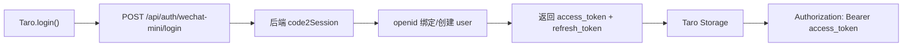

# 微信小程序前端目录能力地图

> 适用代码：`frontend-weapp/`  
> 技术栈：Taro 4 + React + TypeScript + 微信小程序  
> 定位：唯一的微信小程序前端模块。

## 1. 模块边界

- `frontend/`：现有 Next.js H5 前端，不被小程序改造覆盖。
- `frontend-weapp/`：Taro React 微信小程序前端（唯一小程序入口）。

小程序直连 FastAPI `/api/*`，复用现有 `LearningOrchestratorGraph`、聊天 SSE 事件、题包练习、学习记忆和掌握度接口。

## 2. 目录职责

- `src/services/api.ts`：普通 HTTP 请求、Bearer token、refresh、业务 API 封装。
- `src/services/chat-stream.ts`：`enableChunked + onChunkReceived` 解析 `/api/chat` SSE。
- `src/store/auth.ts`：小程序端 access token、refresh token、当前用户缓存。
- `src/store/learning.ts`：当前 notebook、session、题包、聊天草稿缓存。
- `src/types/api.ts`：小程序端消费的后端 payload 类型。
- `src/pages/login`：微信登录。
- `src/pages/chat`：流式问答与题包接收。
- `src/pages/practice`：最新题包/推荐题与作答提交。
- `src/pages/dashboard`：学习记忆与掌握度概览。
- `src/pages/profile`：当前用户、笔记本列表、退出登录。

## 3. 鉴权流



Web 端继续使用 HttpOnly cookie；小程序端使用 Bearer token。`require_current_user` 同时支持两种方式，但当请求里存在 `Authorization: Bearer ...` 时以 Bearer 为准；Bearer 无效会直接 401，不再回退到 cookie。

小程序端会把 `access_token`、`refresh_token`、`user` 存入 Taro Storage。普通 API 和聊天 streaming 共用 refresh 逻辑；聊天遇到 401 会 refresh 后重试一次。退出登录调用 `POST /api/auth/wechat-mini/logout` 主动撤销 refresh token，然后清理本地缓存。

后端部署需要提供：

- `WECHAT_MINI_APP_ID`
- `WECHAT_MINI_APP_SECRET`
- `JWT_SECRET_KEY`
- `DATABASE_URL`
- 模型与向量检索相关环境变量

上线或内测库升级前执行：

```bash
cd backend
alembic upgrade head
```

微信登录错误合同：

- `invalid_code`：code 无效或微信返回未知登录错误。
- `code_used`：code 已使用或过期。
- `rate_limited`：微信接口频控。
- `wechat_unavailable`：微信服务或网络不可用。
- `risk_blocked`：微信风控拦截。
- `missing_config`：后端缺少小程序 appid/secret。

## 4. 聊天流

`src/pages/chat/index.tsx` 调用 `sendChatStream()`，请求体保持：

```json
{
  "user_id": "当前用户 id",
  "session_id": "本地会话 id",
  "question": "用户问题",
  "subject_id": "当前 notebook id"
}
```

小程序端处理 `status`、`routing`、`answer_delta`、`explanation`、`quiz`、`error`、`done`。`quiz` 事件会写入结构化本地题包缓存：

```json
{
  "sessionId": "聊天会话 id",
  "subjectId": "当前 notebook/subject id",
  "items": [],
  "currentIndex": 0,
  "answers": {}
}
```

stream parser 支持注释 heartbeat、多行 `data:`、分块中文、残留 buffer flush、服务端 `error` reason、超时和 abort。

## 5. 运行命令

```bash
cd frontend-weapp
npm install
npm run typecheck
npm run lint
npm run build:weapp
npm run check:weapp
```

微信开发者工具打开仓库根目录下的 `frontend-weapp/`，项目配置里的 `miniprogramRoot` 指向 `dist/`。

`build:weapp` 和 `dev:weapp` 默认带 `--no-check`，用于跳过 Taro doctor 原生校验；当前 macOS 沙箱里该校验包可能 panic 并挂住，跳过后不影响 webpack 编译产物。repo root 的 `make check-weapp` 会直接调用本地 Taro CLI，避免改写本地私有配置。

构建前会生成 `project.private.config.json` 覆盖微信开发者工具 appid。该文件是本地私有配置，已经加入 `.gitignore`。Taro 编译产生的 `.swc/` 缓存也不入库。

联调前设置后端地址和 appid：

```bash
TARO_APP_API_BASE=https://your-domain.example.com/api TARO_APP_ID=wx123... npm run build:weapp
```

如果 `TARO_APP_API_TRANSPORT=container` 用于普通 API，聊天真流式仍需要单独配置 HTTPS request 域名：

```bash
TARO_APP_API_TRANSPORT=container TARO_APP_CHAT_STREAM_API_BASE=https://your-domain.example.com/api TARO_APP_ID=wx123... npm run build:weapp
```

`TARO_APP_CHAT_STREAM_API_BASE` 未设置时会回退到 `TARO_APP_API_BASE`。真机预览/体验版必须把该域名加入微信后台 request 合法域名；云托管 `wx.cloud.callContainer` 只能作为 `/chat/sync` 同步兜底，不能承载 SSE chunked 真流式。

常用脚本：

```bash
npm run build:weapp:dev
TARO_APP_API_BASE=https://staging-api.example.com/api TARO_APP_ID=wx123... npm run build:weapp:staging
npm run check:weapp
```

本地调试可保持默认 `http://127.0.0.1:8000/api`，真机预览必须使用微信后台配置过的 HTTPS request 合法域名。

## 6. 微信后台配置

体验版或真机内测前确认：

- request 合法域名包含后端 HTTPS API 域名，不包含路径，例如 `https://api.example.com`。
- 若开启云托管 transport，聊天流式域名也必须出现在 request 合法域名中。
- 服务器 TLS 证书有效，域名能从公网访问。
- 后端 CORS/网关允许小程序请求的 API 域名。
- 后端已经配置真实 `WECHAT_MINI_APP_ID`、`WECHAT_MINI_APP_SECRET`。
- 微信开发者工具打开 `frontend-weapp/`，`miniprogramRoot` 为 `dist/`，appid 使用真实内测 appid。

## 7. 内测门禁

后端：

```bash
backend/.venv313/bin/python -m unittest backend.tests.test_auth_api backend.tests.test_graph_migrations
make test-graphs
```

小程序：

```bash
cd frontend-weapp
npm run typecheck
npm run lint
npm run build:weapp
```

真机检查：

- iOS 和 Android 都能完成微信登录。
- `/subjects` 返回后可切换 notebook。
- 聊天有首包、增量输出和结束态。
- access token 过期后普通 API 和聊天都能自动 refresh。
- 聊天生成题包后刷题页能读取同一个 `sessionId/subjectId`。
- 刷题提交成功后 Dashboard 数据可刷新。
- 退出登录后旧 refresh token 不能继续刷新。

## 8. 发布和回滚

- `dist/`、`node_modules/`、`project.private.config.json` 不入库；发布以 `frontend-weapp/` 源码、`package-lock.json` 和构建环境变量为准。
- 体验版上传前记录 API 域名、appid、后端镜像/tag、数据库 migration 版本。
- 重点观察登录失败率、聊天完成率、题包生成成功率、attempt 保存成功率和平均耗时。
- 回滚优先切回上一版体验版；若后端登录合同异常，回滚后端镜像并确认 `wechat_mini_identities` migration 保留不影响旧版本运行。
