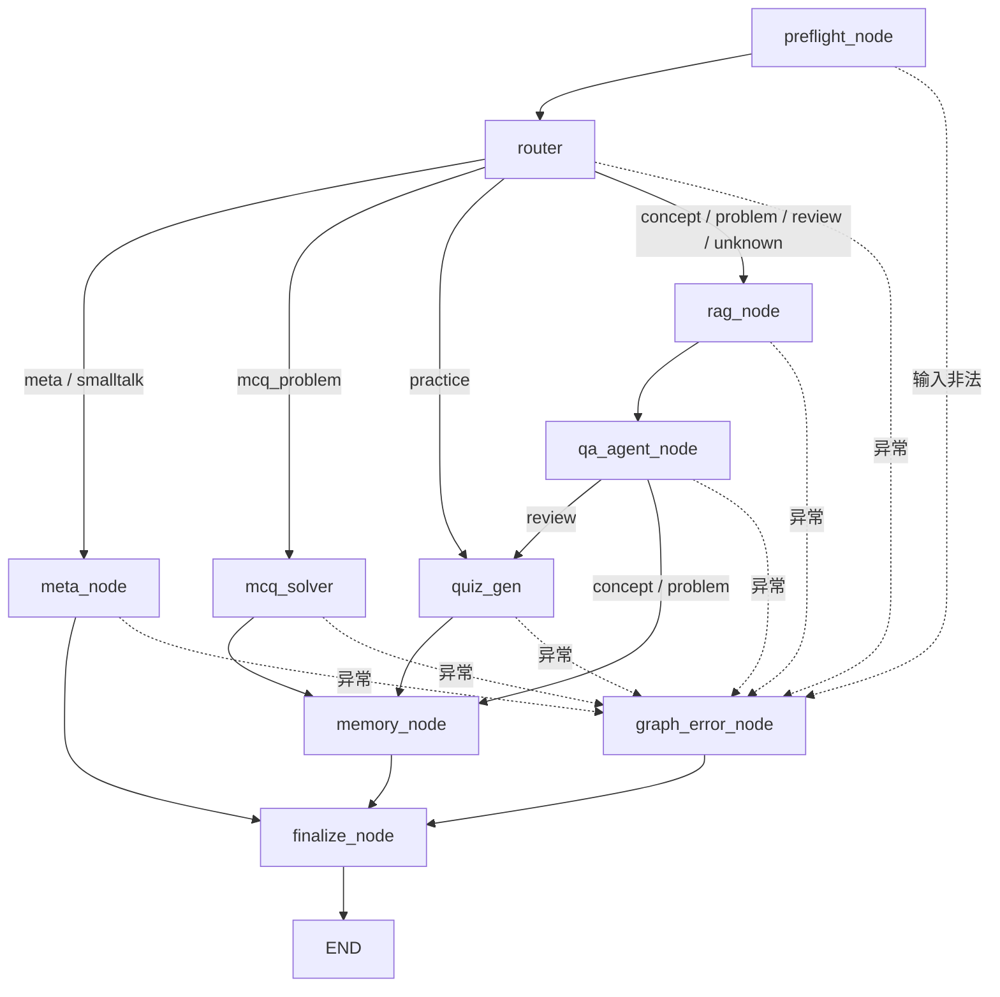
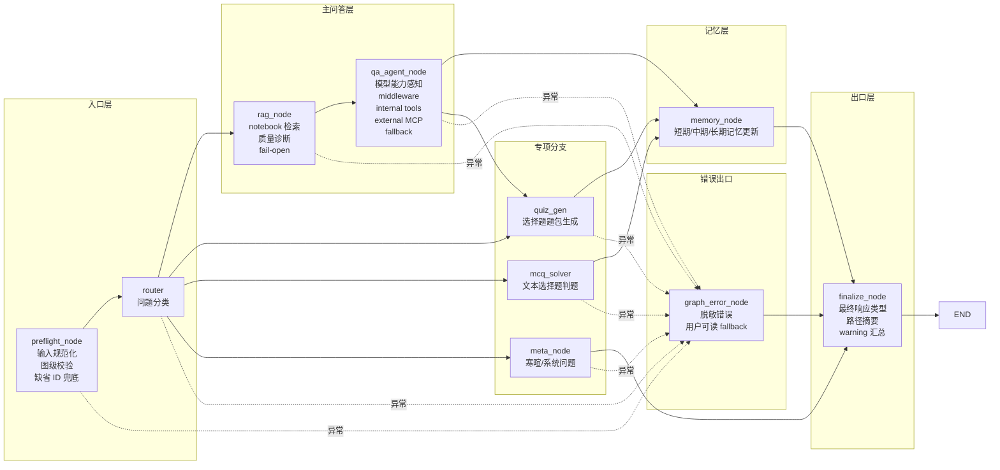
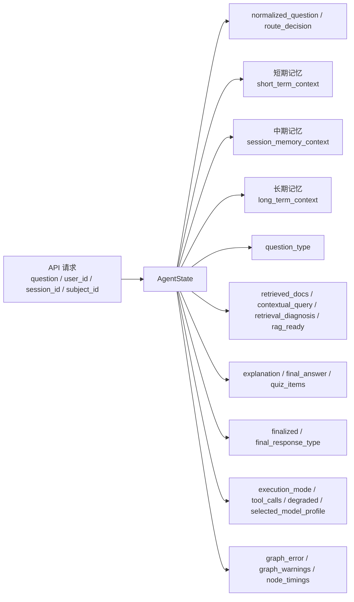

# LangGraph 工作流总览

这份文档专门解释当前项目里 LangGraph 的职责、节点分工、状态流向和持久化方式，适合刚接手项目时快速建立心智模型。

## 一句话理解

这个项目里的 LangGraph 不是“万能大 Agent”，而是后端主学习链路的**编排层**：

- `preflight_node` 负责入口校验、输入规范化和缺省 ID 兜底
- `router` 负责问题分类
- `rag_node` 负责 notebook RAG 预检索、质量诊断和上下文写入
- `qa_agent_node` 负责主问答 runtime
- `quiz_gen` 负责出题
- `mcq_solver` 负责选择题判题
- `meta_node` 负责元问题和寒暄
- `memory_node` 负责把本轮学习结果收口进记忆
- `finalize_node` 负责统一收口最终响应、降级状态和观测字段

## 当前图结构

主定义在 [backend/app/orchestration/graph/graph.py](/Users/xiaomu/Desktop/Python/Code/learning-assistant/backend/app/orchestration/graph/graph.py)。



## 节点职责图



## 节点说明

### `preflight_node`

文件：
- [backend/app/orchestration/graph/graph.py](/Users/xiaomu/Desktop/Python/Code/learning-assistant/backend/app/orchestration/graph/graph.py)

职责：
- 折叠用户问题里的多余空白，写入 `normalized_question`
- 拒绝空问题，并进入 `graph_error_node`
- 对缺失的 `user_id`、`session_id`、`subject_id` 写入安全默认值和 `graph_warnings`
- 对超长问题做图级裁剪，避免后续节点在无边界输入上执行

说明：
- 这是图入口，不替代 QA runtime 里的模型上下文裁剪；它只负责最基础的图级安全边界

### `router`

文件：
- [backend/app/orchestration/agents/router.py](/Users/xiaomu/Desktop/Python/Code/learning-assistant/backend/app/orchestration/agents/router.py)

职责：
- 读取用户问题和上下文
- 分类为：
  - `concept`
  - `problem`
  - `review`
  - `practice`
  - `meta`
  - `smalltalk`
  - `mcq_problem`

说明：
- 先走规则匹配
- 再用 LLM structured output 做补充分类

### `rag_node`

文件：
- [backend/app/orchestration/agents/rag.py](/Users/xiaomu/Desktop/Python/Code/learning-assistant/backend/app/orchestration/agents/rag.py)
- [backend/app/services/rag/rag_service.py](/Users/xiaomu/Desktop/Python/Code/learning-assistant/backend/app/services/rag/rag_service.py)

职责：
- 只在 `concept / problem / review / unknown fallback` 主问答路径执行
- 调用正式 RAG 模块完成 notebook 检索与质量诊断
- 写入 `retrieved_docs`、`contextual_query`、`retrieval_diagnosis`、`rag_ready`
- 检索失败时 fail-open：写入 `graph_warnings`，继续交给 `qa_agent_node`

说明：
- 这个节点不生成最终回答，也不直接调用讲解模型
- 它让 LangGraph Studio 可以清楚看到 RAG 是否命中、命中质量如何

### `qa_agent_node`

文件：
- [backend/app/orchestration/agents/qa_agent.py](/Users/xiaomu/Desktop/Python/Code/learning-assistant/backend/app/orchestration/agents/qa_agent.py)
- [backend/app/domains/qa/runtime.py](/Users/xiaomu/Desktop/Python/Code/learning-assistant/backend/app/domains/qa/runtime.py)

职责：
- 这是现在主问答的回答生成节点
- 内部执行流程是：
  1. `create_agent`
  2. 查询 `model profile`
  3. `preprocess middleware`
  4. 决定 `direct_answer / tool_calling / structured_output / deterministic_context`
  5. 如需工具，执行内部工具或外部 MCP
  6. `postprocess middleware`
  7. 如失败则 fallback

说明：
- `concept / problem / review` 现在先经过 `rag_node`，再走这里
- 当 `rag_node` 已经写入检索结果时，确定性 fallback 会直接复用这些结果，不重复检索
- `review` 之后还会继续去 `quiz_gen`

### `quiz_gen`

文件：
- [backend/app/orchestration/agents/quiz.py](/Users/xiaomu/Desktop/Python/Code/learning-assistant/backend/app/orchestration/agents/quiz.py)

职责：
- 生成 4 选 1 单选题
- 优先从题库表取题
- 不够时再走 AI 补题

会在哪些路径出现：
- `practice`
- `review`

### `mcq_solver`

文件：
- [backend/app/orchestration/agents/mcq_solver.py](/Users/xiaomu/Desktop/Python/Code/learning-assistant/backend/app/orchestration/agents/mcq_solver.py)

职责：
- 处理用户在聊天里直接贴出来的单选题文本
- 输出正确选项、解析和干扰项解释

### `meta_node`

文件：
- [backend/app/orchestration/agents/meta.py](/Users/xiaomu/Desktop/Python/Code/learning-assistant/backend/app/orchestration/agents/meta.py)

职责：
- 处理“你是什么模型”“我们刚才讲到哪了”“你好”这类问题
- 不走主问答检索链路

### `memory_node`

文件：
- [backend/app/orchestration/agents/memory.py](/Users/xiaomu/Desktop/Python/Code/learning-assistant/backend/app/orchestration/agents/memory.py)
- [backend/app/domains/memory/service.py](/Users/xiaomu/Desktop/Python/Code/learning-assistant/backend/app/domains/memory/service.py)

职责：
- 更新长期学习画像
- 更新会话摘要层
- 收口本轮学习结果

说明：
- 大多数学习型路径最终都会到这里

### `graph_error_node`

文件：
- [backend/app/orchestration/graph/graph.py](/Users/xiaomu/Desktop/Python/Code/learning-assistant/backend/app/orchestration/graph/graph.py)

职责：
- 作为图级统一错误出口
- 接收节点 wrapper 写入的脱敏 `graph_error`
- 返回用户可读 fallback，并设置 `degraded=true`

说明：
- QA runtime 内部已有 tool / structured / RAG fallback，能内部降级的错误不会上抛到这里
- `memory_node` 失败只写入 `graph_warnings`，不覆盖已经生成的回答
- 错误 state 不写入 API key、数据库 DSN、邮箱等敏感信息

### `finalize_node`

文件：
- [backend/app/orchestration/graph/graph.py](/Users/xiaomu/Desktop/Python/Code/learning-assistant/backend/app/orchestration/graph/graph.py)

职责：
- 汇总最终响应类型：`explanation / quiz / text / error / empty`
- 写入 `finalized=true`
- 写入 `route_decision`，方便 LangGraph Studio 和 LangSmith 快速看懂实际路径
- 对空结果生成可读 fallback，并追加 `graph_warnings`

说明：
- 所有正常和错误路径都会进入这里，因此 sync、SSE 和 Studio 看到的最终 state 是一致的

## 状态数据流

全图共享一个 `AgentState`，定义在 [backend/app/shared/schemas/state.py](/Users/xiaomu/Desktop/Python/Code/learning-assistant/backend/app/shared/schemas/state.py)。



### `AgentState` 里最重要的字段

- 会话身份：
  - `user_id`
  - `session_id`
- notebook 兼容字段：
  - `subject_id`
  - `subject_name`
  - `subject_description`
- 三层记忆：
  - `short_term_context`
  - `session_memory_context`
  - `long_term_context`
- 主问答中间结果：
  - `normalized_question`
  - `question_type`
  - `route_decision`
  - `retrieved_docs`
  - `contextual_query`
  - `explanation`
  - `final_answer`
- 调试信息：
  - `execution_mode`
  - `tool_calls`
  - `degraded`
  - `selected_model_profile`
- 图级观测：
  - `finalized`
  - `final_response_type`
  - `graph_error`
  - `graph_warnings`
  - `node_timings`

## 运行时与持久化

文件：
- [backend/app/orchestration/workflow/runner.py](/Users/xiaomu/Desktop/Python/Code/learning-assistant/backend/app/orchestration/workflow/runner.py)
- [backend/app/orchestration/workflow/runtime.py](/Users/xiaomu/Desktop/Python/Code/learning-assistant/backend/app/orchestration/workflow/runtime.py)

### `runner.py`

提供两个统一入口：

- `run_workflow(state)`：同步执行
- `stream_workflow(state)`：流式执行

这里还会统一构建 LangGraph config：

- `thread_id = session_id`
- metadata 里带：
  - `session_id`
  - `user_id`
  - `subject_id`
  - `request_mode`

### `runtime.py`

职责：
- 编译 LangGraph
- 管理全局 compiled graph 生命周期
- 绑定 Postgres checkpointer

当前使用：
- `PostgresSaver`
- 同一 `session_id` 会被当成 LangGraph 的 `thread_id`

## 和产品层的关系

这里有一个很重要的兼容规则：

- 产品层叫 **notebook / 笔记本**
- 后端内部很多地方仍保留 `subject` 命名

所以你在 LangGraph state 和 metadata 里看到的：

- `subject_id`
- `subject_name`

在产品语义上都等价于当前 notebook。

## 主问答 fallback 在哪里

旧的独立 `retriever` / `explain_node` LangGraph 节点已经移除。当前图层保留一个轻量 `rag_node`，只负责 RAG 预检索和诊断；讲解、工具调用和降级逻辑仍收口在 `qa_agent_node` 内部：

- `backend/app/orchestration/agents/qa_agent.py` 负责把 LangGraph state 转成 QA runtime 请求
- `backend/app/domains/qa/runtime.py` 负责选择 direct / tool / structured / deterministic fallback
- `backend/app/orchestration/agents/rag.py` 负责 LangGraph 可见的 RAG 预检索
- `backend/app/services/rag/*` 是 RAG 正式能力模块
- `backend/app/domains/qa/retrieval_fallback.py` 只保留非预检索路径的确定性 RAG fallback
- `backend/app/domains/qa/explanation_fallback.py` 负责确定性讲解 fallback

当前主线是：

```text
preflight_node -> router -> rag_node -> qa_agent_node -> memory_node -> finalize_node
preflight_node -> router -> rag_node -> qa_agent_node -> quiz_gen -> memory_node -> finalize_node
preflight_node -> router -> ...异常... -> graph_error_node -> finalize_node
```

## LangGraph Platform 部署入口

本项目现在额外提供 LangGraph Platform sidecar 配置：

- `backend/langgraph.json`
- `backend/app/orchestration/platform/graph.py`
- `backend/app/orchestration/platform/webapp.py`

用途：
- 在 LangSmith Cloud / LangGraph Platform 中部署兼容名 `learning_assistant`
- 让 Studio 直接查看节点、边、state 和 trace
- 与 FastAPI `/api/chat*` 共享新 `LearningOrchestratorGraph` 入口；`learning_assistant` 只是外部兼容导出名，不再指向旧单体 graph

## 推荐阅读顺序

如果你第一次接手这套 LangGraph，建议按下面顺序看：

1. [backend/app/orchestration/graphs/orchestrator/graph.py](/Users/xiaomu/Desktop/Python/Code/learning-assistant/backend/app/orchestration/graphs/orchestrator/graph.py)
2. [backend/app/orchestration/graphs/orchestrator/intent_rules.py](/Users/xiaomu/Desktop/Python/Code/learning-assistant/backend/app/orchestration/graphs/orchestrator/intent_rules.py)
3. [backend/app/orchestration/graphs/orchestrator/child_invokers.py](/Users/xiaomu/Desktop/Python/Code/learning-assistant/backend/app/orchestration/graphs/orchestrator/child_invokers.py)
4. [backend/app/orchestration/graphs/qa/graph.py](/Users/xiaomu/Desktop/Python/Code/learning-assistant/backend/app/orchestration/graphs/qa/graph.py)
5. [backend/app/orchestration/graphs/question_generation/graph.py](/Users/xiaomu/Desktop/Python/Code/learning-assistant/backend/app/orchestration/graphs/question_generation/graph.py)
6. [backend/app/orchestration/graphs/mastery/graph.py](/Users/xiaomu/Desktop/Python/Code/learning-assistant/backend/app/orchestration/graphs/mastery/graph.py)

## 一句话结论

这个项目里的企业级 LangGraph 主要负责两件事：

- 由 `LearningOrchestratorGraph` 把用户请求路由到 QA、出题或掌握度子图
- 用 shared contract、repository Protocol 和 capability tooling 约束子图协作边界

真正复杂的教学回答、题目生成和掌握度更新分别留在对应业务 Graph / domain service 内，Orchestrator 只做编排、组合与审计。
