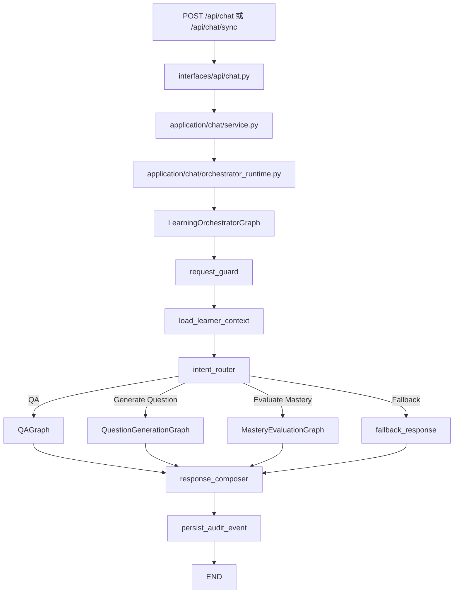

# LangGraph 工作流总览

这份文档说明当前项目里的 Graph 职责、边界和入口。当前事实源是 `backend/app/orchestration/graphs/*` 和 `backend/app/application/chat/orchestrator_runtime.py`。

## 一句话理解

LangGraph 在这个项目里是学习链路的编排层，不再使用旧的单体 workflow / agents 包。

- `LearningOrchestratorGraph`：请求守卫、上下文加载、意图路由、子图调用、响应组合、审计。
- `QAGraph`：问答、证据判断、工具 fallback、grounding、`LearningEvent`。
- `QuestionGenerationGraph`：出题、质量检查、修复、题目持久化。
- `MasteryEvaluationGraph`：消费做题记录和 `LearningEvent`，更新掌握度。
- `qa_agent_node` 等旧名称只在 SSE/presenter 兼容层作为事件名出现，不代表旧 Python agents 包仍在运行。

## 当前图结构

## 子图边界

- Orchestrator 只负责路由和组合，不直接写 mastery，不直接硬编码工具 provider。
- QAGraph 通过 tooling capability 检索 notebook 或 web，不直接 import Tavily provider。
- QuestionGenerationGraph 只负责题目生成与持久化，不更新 `mastery_snapshots`。
- MasteryEvaluationGraph 只消费事件和 attempts，不负责生成题目或回答用户问题。
- Graph State 不保存 DB connection、LLM client、tool instance 这类运行时对象。

## 持久化与观测

- 产品历史仍以 `chat_sessions` 为事实来源，LangGraph checkpoint 不替代前端历史页。
- Graph-era facts 与 mastery 相关表由 Alembic 管理。
- LangSmith tracing 是可选观测能力，配置缺失或服务异常时业务 fail-open。
- SSE 过程面板使用兼容事件名，以保持前端展示稳定。

## 关键源码

- [orchestrator graph](/Users/xiaomu/Desktop/Python/Code/learning-assistant/backend/app/orchestration/graphs/orchestrator/graph.py)
- [QA graph](/Users/xiaomu/Desktop/Python/Code/learning-assistant/backend/app/orchestration/graphs/qa/graph.py)
- [question generation graph](/Users/xiaomu/Desktop/Python/Code/learning-assistant/backend/app/orchestration/graphs/question_generation/graph.py)
- [mastery graph](/Users/xiaomu/Desktop/Python/Code/learning-assistant/backend/app/orchestration/graphs/mastery/graph.py)
- [chat orchestrator runtime](/Users/xiaomu/Desktop/Python/Code/learning-assistant/backend/app/application/chat/orchestrator_runtime.py)
