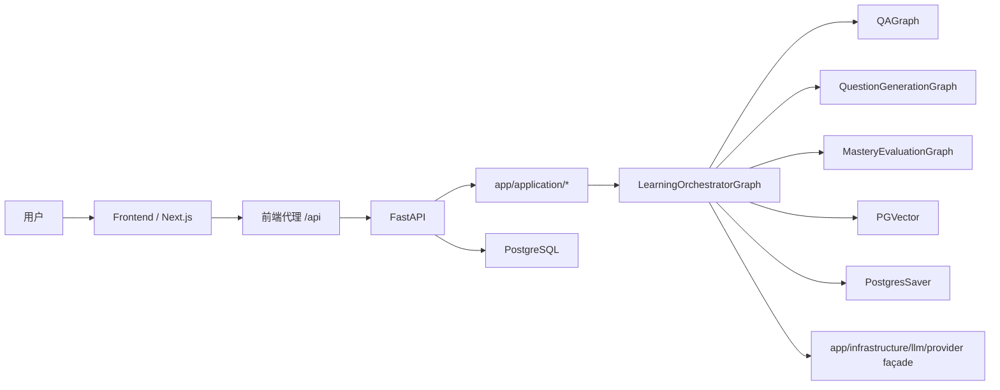

# 多 Agent 学习助手技术文档

> 更新日期：2026-04-25

## 1. 总体架构



## 2. 分层约束

```text
app.main
  -> app.interfaces
  -> app.application
  -> app.orchestration
  -> app.domains / app.services / app.infrastructure
  -> app.shared
```

- `app/interfaces/*` 只负责接入层协议
- `app/application/*` 只负责用例编排，不直接实现底层基础设施，也不直接抛 `HTTPException`
- `app/orchestration/*` 只负责图编排、节点装配、runner、checkpointer 生命周期
- `app/domains/*` 只负责 QA / memory / practice 领域逻辑
- `app/infrastructure/db/repositories/__init__.py` 只导出正式 record 仓储能力，真实实现已拆到 `db/repositories/*`
- `app/services/retrieval/*` 已删除；正式 RAG 入口是 `app/services/rag/{loader,splitter,embeddings,vector_store,retriever,rag_service}.py`
- `app/infrastructure/llm/provider.py` 是模型与 Embedding façade；真实实现拆在 `config.py / catalog.py / clients.py`
- `app/services/tools/runtime.py` 是 QA 工具聚合入口；registry、internal tools、MCP tools 已拆到 `app/services/tools/*`
- `app/services/notebook_knowledge_base.py` 是 notebook 知识库 gateway，负责文档计数、知识库删除和内容写入
- `app/interfaces/*` 是唯一 HTTP 翻译层：application 错误与内部契约都在这里映射成现有 API 响应

## 3. 存储策略

### 3.1 PostgreSQL

- 当前运行时只支持 PostgreSQL
- `app/infrastructure/db/database.py` 会规范化 `DATABASE_URL`
- 启动时自动执行 `CREATE EXTENSION IF NOT EXISTS vector`
- 业务表 JSON 字段统一切换为 `JSONB`

### 3.2 PGVector

- 资料入库、URL 抓取、自动生成知识内容都写入 PGVector
- 默认 collection 命名：`learning_<subject_id>`
- 通用 collection：`learning_docs`

### 3.3 LangGraph

- 生产入口由 [backend/app/orchestration/graphs/orchestrator/graph.py](/Users/xiaomu/Desktop/Python/Code/learning-assistant/backend/app/orchestration/graphs/orchestrator/graph.py) 管理
- 使用 `PostgresSaver` 编译 graph
- `session_id` 同时作为 LangGraph `thread_id`
- `chat_sessions` 仍然是前端历史页的事实来源，不被 checkpointer 替代

## 4. 工作流

### 4.1 路径

- `concept / problem / review` → `LearningOrchestratorGraph -> QAGraph -> response_composer`
- `practice` → `LearningOrchestratorGraph -> QuestionGenerationGraph -> response_composer`
- `mastery` → `LearningOrchestratorGraph -> MasteryEvaluationGraph -> response_composer`
- 请求守卫或子图异常 → `LearningOrchestratorGraph` 的 fallback / response composer 生成安全响应

### 4.2 三层记忆

- 短期记忆：当前 `session_id` 最近几轮消息
- 中期记忆：`chat_sessions.session_memory`
- 长期记忆：`user_memories + user_profiles`

## 5. 迁移策略

### 5.1 结构化数据

- 源端可为 MySQL / SQLite / PostgreSQL
- 目标端统一为 PostgreSQL
- 通过 [migrate_structured_data_to_postgres.py](/Users/xiaomu/Desktop/Python/Code/learning-assistant/backend/scripts/migrate_structured_data_to_postgres.py) 执行

### 5.2 向量数据

- 当前运行时向量库为 PGVector。
- Chroma 只作为历史迁移背景保留，不再提供项目内迁移脚本。

## 6. 运维默认栈

- Docker Compose 只保留 `postgres + backend + frontend`
- 本地开发不再存在 SQLite 自动回退
- 历史 MySQL / Chroma 只通过一次性迁移脚本接入
