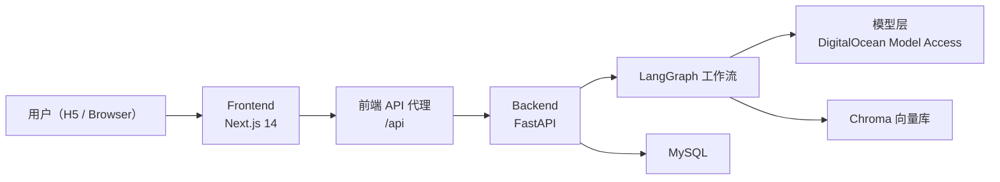
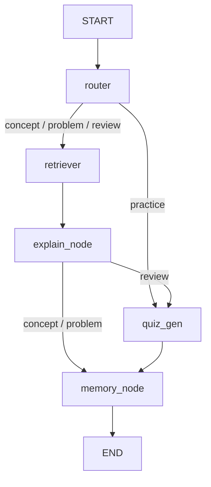
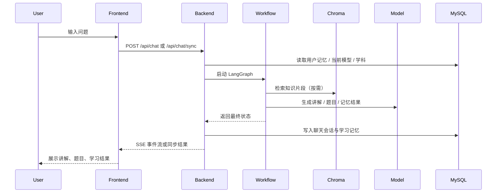

# 多 Agent 学习助手技术文档

> 版本：v0.1  
> 更新日期：2026-04-12  
> 对应代码仓库：`learning-assistant`

## 1. 技术目标

本文档描述当前项目的技术架构、模块职责、数据流、核心表结构、部署方式与关键实现约束，适合作为开发接手、后续迭代和排障的基础文档。

## 2. 总体架构

系统采用前后端分离架构：

- 前端：Next.js 14 H5 应用，负责页面渲染、用户交互和后端 API 代理。
- 后端：FastAPI 应用，提供 REST API、SSE 流式接口和 LangGraph 工作流。
- 向量库：Chroma，按学科隔离知识集合。
- 结构化数据库：MySQL，保存学科、学习记忆、聊天历史、应用设置。
- 模型服务：通过 DigitalOcean Model Access（OpenAI 兼容接口 + `pydo` SDK）提供。



## 3. 技术栈

### 3.1 前端

- Next.js 14.2.29
- React 18
- TypeScript 5
- Tailwind CSS 3
- Lucide React 图标库

前端采用 App Router 结构，当前以 H5 移动端优先设计为主。页面以 `/chat`、`/practice`、`/dashboard` 为核心，样式上已切换为统一的移动端视觉体系。

### 3.2 后端

- FastAPI
- Uvicorn
- Pydantic v2
- SSE Starlette
- Loguru

后端以 API 路由 + LangGraph 工作流的方式组织，其中 API 层负责接入与响应，工作流层负责具体的智能处理链路。

### 3.3 Agent / LLM 相关

- LangChain
- LangGraph
- langchain-openai
- pydo

当前模型层通过统一的 `model_provider` 抽象封装，兼容：

- 模型调用：OpenAI 兼容 Chat API
- 模型列表拉取：DigitalOcean `pydo` SDK
- 当前模型选择：MySQL `app_settings` 表

### 3.4 数据与存储

- MySQL：结构化业务数据
- SQLAlchemy：ORM 与数据访问
- PyMySQL：MySQL 驱动
- ChromaDB：向量检索
- pypdf：PDF 解析
- BeautifulSoup + requests：网页抓取

## 4. 目录结构说明

```text
learning-assistant/
├── backend/
│   ├── api/                # FastAPI 路由
│   ├── agents/             # 各类 Agent 实现
│   ├── db/                 # 数据库连接、模型、仓储
│   ├── graph/              # LangGraph 工作流
│   ├── schemas/            # Pydantic / 状态模型
│   ├── tools/              # 模型、检索等工具层
│   └── main.py             # 后端入口
├── frontend/
│   ├── app/                # Next.js 页面
│   ├── components/         # 前端组件
│   ├── lib/                # API 封装 / 本地状态工具
│   └── public/             # 静态资源
├── docs/                   # 项目文档
└── docker-compose.yml      # 容器编排
```

## 5. 核心模块设计

### 5.1 前端模块

#### 5.1.1 页面

- `/chat`：主学习页，负责学科切换、模型切换、资料上传、问答和知识讲解展示。
- `/practice`：刷题页，展示最近一次题包。
- `/dashboard`：学习中心，展示学习记忆、近期主题、薄弱点等信息。

#### 5.1.2 API 封装

前端统一通过 `frontend/lib/api.ts` 与后端交互，主要包含：

- `sendChatSSE`
- `fetchSubjects`
- `uploadPDFWithSubject`
- `ingestUrls`
- `fetchUserMemory`
- `fetchSessions`
- `fetchLatestQuiz`
- `fetchModelConfig`
- `updateModelConfig`

#### 5.1.3 前端代理

前端运行时 `API_BASE` 默认为 `/api`。在 Docker 环境下，前端容器通过 `INTERNAL_API_BASE=http://backend:8000/api` 访问后端，从而避免浏览器直连容器内网地址。

### 5.2 后端 API 模块

- `api/chat.py`：聊天接口，支持 SSE 与同步响应。
- `api/subjects.py`：学科 CRUD 与学科知识框架自动生成。
- `api/upload.py`：PDF 上传与 URL 入库。
- `api/user_data.py`：学习记忆、聊天历史、最新题包。
- `api/model_config.py`：聊天模型查询与切换。

### 5.3 Agent 工作流模块

系统工作流基于 LangGraph `StateGraph` 实现，主要节点为：

- `router`
- `retriever`
- `explain_node`
- `quiz_gen`
- `memory_node`



#### 5.3.1 路由规则

- `concept` / `problem`：检索后讲解，再更新记忆。
- `practice`：直接出题，再更新记忆。
- `review`：检索、讲解、出题，再更新记忆。

#### 5.3.2 聊天持久化

工作流结束后，后端会将本轮用户消息、AI 回复和最新题包写入 MySQL 的 `chat_sessions` 表。

### 5.4 模型配置模块

模型配置采用统一 Provider 层，核心职责如下：

1. 兼容 `MODEL_ACCESS_KEY` 与 `OPENAI_API_KEY`。
2. 统一 DigitalOcean OpenAI 兼容 Base URL。
3. 通过 `pydo` 拉取当前账号可用模型列表。
4. 过滤掉 Claude 与非聊天模型。
5. 按模型家族进行标注与排序。
6. 将当前聊天模型写入 `app_settings.chat_model`。

当前允许展示的模型家族包括：

- GPT
- Gemini
- Qwen
- Llama
- GLM
- Kimi
- DeepSeek
- 其他符合规则的非 Claude 模型

说明：

- 模型列表是动态的，取决于账号实际可见模型。
- 截至 2026-04-12，本项目实测可正常使用 `openai-gpt-oss-20b`。
- 某些模型如 `openai-gpt-4o` 可能因账号层级限制而被校验拒绝。

## 6. 数据流设计

### 6.1 问答链路



### 6.2 知识入库链路

1. 前端上传 PDF 或输入 URL。
2. 后端解析文本。
3. 文本按规则切块。
4. Embedding 后写入指定学科的 Chroma Collection。
5. 学科详情和列表中通过 Collection 统计文档数。

## 7. 数据库设计

### 7.1 核心表

#### `subjects`

| 字段 | 类型 | 说明 |
| --- | --- | --- |
| `id` | varchar(64) | 学科 ID |
| `name` | varchar(100) | 学科名称 |
| `icon` | varchar(16) | 学科图标 |
| `description` | text | 学科描述 |
| `created_at` | datetime | 创建时间 |

#### `user_memories`

| 字段 | 类型 | 说明 |
| --- | --- | --- |
| `user_id` | varchar(100) | 用户 ID，主键 |
| `weak_points` | json | 薄弱点列表 |
| `error_count` | json | 错误统计 |
| `recent_topics` | json | 最近学习主题 |
| `last_session` | varchar(200) | 最近会话 ID |
| `updated_at` | datetime | 更新时间 |

#### `chat_sessions`

| 字段 | 类型 | 说明 |
| --- | --- | --- |
| `id` | varchar(100) | 会话 ID，主键 |
| `user_id` | varchar(100) | 用户 ID |
| `subject_id` | varchar(64) | 学科 ID |
| `title` | varchar(120) | 会话标题 |
| `messages` | json | 消息列表 |
| `latest_quiz` | json | 最近题包 |
| `created_at` | datetime | 创建时间 |
| `updated_at` | datetime | 更新时间 |

#### `app_settings`

| 字段 | 类型 | 说明 |
| --- | --- | --- |
| `key` | varchar(100) | 配置键 |
| `value` | text | 配置值 |
| `updated_at` | datetime | 更新时间 |

当前已使用的配置项：

- `chat_model`：当前生效的聊天模型 ID

## 8. 向量库设计

系统按学科创建独立 Chroma Collection，命名规则如下：

```text
learning_{subject_id}
```

例如：

- `learning_general`
- `learning_computer_network`

这样可以避免不同学科的知识相互干扰，并方便删除单学科知识库。

## 9. 环境变量设计

建议的关键环境变量如下：

| 变量 | 说明 |
| --- | --- |
| `MODEL_ACCESS_KEY` | 数据海洋 / DigitalOcean 模型密钥 |
| `OPENAI_API_KEY` | 兼容旧实现的别名变量 |
| `OPENAI_BASE_URL` | OpenAI 兼容接口地址，默认指向 DO inference |
| `OPENAI_MODEL` | 默认聊天模型 |
| `OPENAI_EMBEDDING_MODEL` | Embedding 模型 |
| `DATABASE_URL` | MySQL 连接串 |
| `CHROMA_HOST` | Chroma 服务地址 |
| `CHROMA_PORT` | Chroma 服务端口 |

## 10. Docker 部署设计

当前 `docker-compose.yml` 包含以下服务：

- `frontend`
- `backend`
- `chroma`
- `mysql`（可选 profile）

部署原则：

1. 浏览器访问前端容器暴露的 `3000` 端口。
2. 前端通过容器内网访问后端。
3. 后端访问 MySQL 与 Chroma。
4. 数据库与向量库使用 volume 持久化。

## 11. 已验证的运行状态

当前版本已完成如下验证：

1. MySQL 可连接，核心表已创建。
2. 后端健康检查通过。
3. 学科接口、用户数据接口、模型配置接口可用。
4. 前端构建和 Lint 通过。
5. AI 问答链路已完成真实调用测试。
6. 模型切换已完成真实调用测试。

## 12. 已知技术风险

1. 当前缺少用户认证，默认以 `default_user` 运行。
2. 模型可用性依赖外部平台与账号权限。
3. 浏览器若直接访问宿主机端口，可能与本机已有开发服务冲突。
4. 生产环境中 CORS、密钥管理、日志审计仍需进一步收敛。

## 13. 建议的后续技术演进

1. 增加鉴权体系和用户隔离。
2. 为会话详情、继续追问引入更清晰的数据结构。
3. 引入异步任务队列处理大文件入库。
4. 增加观测能力，如请求链路日志、错误监控、模型耗时统计。
5. 为前后端增加自动化测试和接口契约测试。
